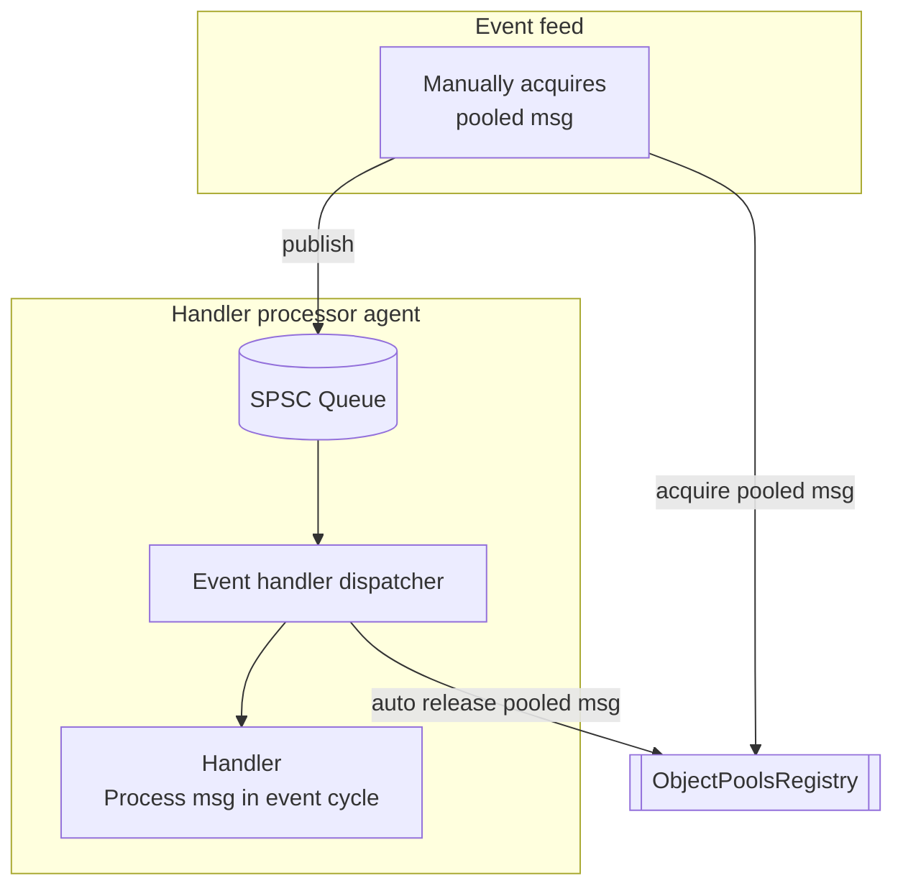
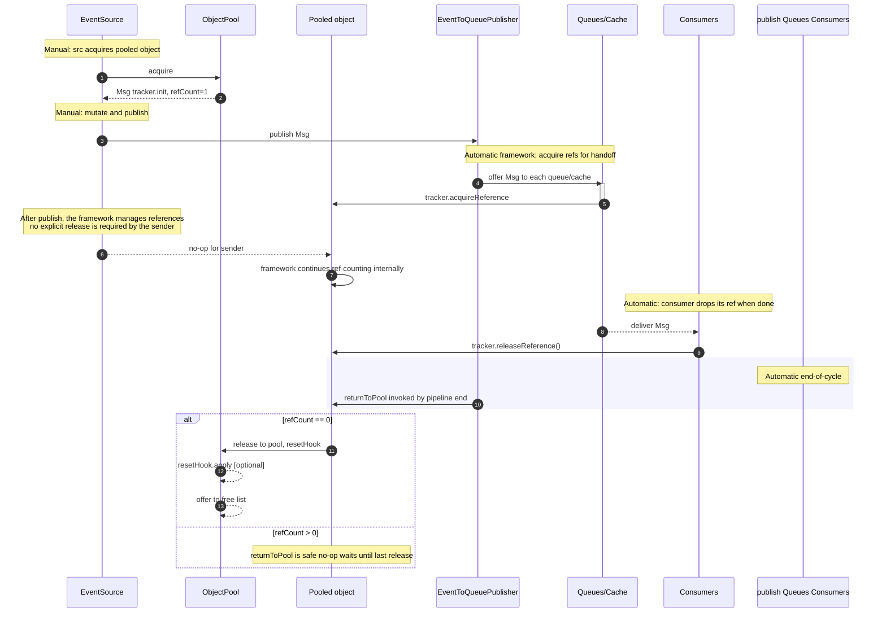
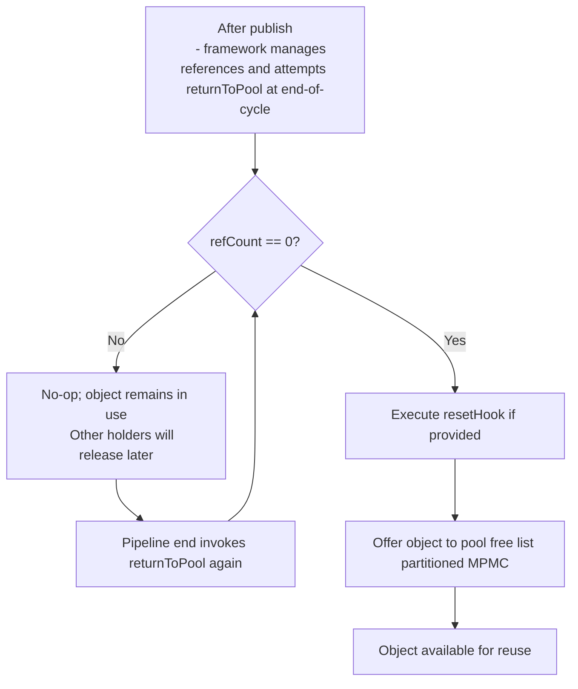

# Object pooling architecture


This document describes how the Mongoose Server object pool works under the hood. It is intended for developers who need
a deeper understanding of reference counting, pooling queues, partitions, and integration points with the runtime.


- PoolAware: marker interface implemented by pooled objects. Implementations must expose a PoolTracker via getPoolTracker(). The framework manages lifecycle; event authors do not need to use try-with-resources.

- PoolTracker: manages reference counting for a pooled object and coordinates return to the originating pool.
    - acquireReference(): increment the reference count.
    - releaseReference(): decrement the reference count; the release that takes it to zero returns the object to its pool. The count never goes negative: a release with no reference held, while the object is out of the pool, throws IllegalStateException; a late release after the return is a no-op.
    - returnToPool(): return the object to its pool if the reference count is zero. The method is idempotent and concurrency-safe; with the last release already returning the object it is rarely needed.
- ObjectPool<T extends PoolAware>: creates and recycles instances of T. When an instance is acquired, its PoolTracker is initialised with the originating pool and the reset hook, and ref count is set. When returned, an optional reset hook is invoked and the instance is placed on the pool’s free list.
- ObjectPools: a shared registry mapping a class to a single ObjectPool instance. Provides convenient getOrCreate overloads to configure capacity and partitions.

## Diagram of object pooling flow 



## Capacity, partitions, and queues

- Capacity: the total number of instances that may be created for a given class. The pool will create on demand up to the configured capacity.
- Partitions: the pool’s free list is partitioned to reduce cross-thread contention; each partition is a bounded, lock-free MPMC queue using org.agrona.concurrent.ManyToManyConcurrentArrayQueue.
- Default partitions: by default, partitions ~= min(available processors, 8) rounded to a power of two. You can specify both capacity and partitions explicitly via ObjectPools.getOrCreate(type, factory, reset, capacity, partitions).

### Free list
- The pool maintains an array of MPMC queues (freePartitions). The current thread computes a home partition index and tries to poll/offer there first, then steals from others under pressure.
- Offer never blocks permanently: if a partition is temporarily full, the pool rotates to the next partition to avoid stalls.

## Lifecycle and reference counting

- Acquire: pool.acquire() returns a pooled instance. Internally, if a free instance is available it is used; otherwise, the pool may create a new instance up to capacity. The instance’s tracker.init(...) sets refCount to 1 and clears the returned flag.
- Additional references: any component that intends to hold a reference (e.g., a queue, cache, or consumer) must call acquireReference() and later releaseReference().
- Origin release: no action is required by the sender. The reference acquire() handed out passes to the publisher on publish; the publisher holds it until every target queue holds its own reference, then releases it.
- Returning to pool: the release that takes the count to zero returns the instance, exactly once per cycle. returnToPool() is safe to call multiple times and from multiple threads and returns the instance only at zero.
- Exhaustion: at capacity, acquire() waits (spin, then yield) until an instance is returned and never returns null. A leaked reference therefore shows as a publisher waiting in acquire() for good once the pool has run dry.
- Reset: an optional reset hook is invoked just before an instance is placed on the free list, allowing the caller to clear state.

## Integration with dispatch/pipeline

- EventToQueuePublisher and caches: a published pooled item is cached as a String snapshot and the cache holds no reference. An item given to cache() is detached from the pool (via PoolTracker.removeFromPool), replaced by a fresh instance in the pool, and cached as-is; a detached item's references are not counted. For each queue write, a reference is acquired before the offer and released if the offer is abandoned.
- Publisher: holds the origin reference until every queue has its reference, then releases it (telaminai/mongoose#54: released first, the first consumer to finish could recycle the item while it was still being offered to the next queue).
- Consumers: EventQueueToEventProcessorAgent releases its queue's reference after the event has been dispatched to every processor on that queue, never before; the last release returns the event to its pool.

## Threading model and safety

- Multi-producer/multi-consumer: the pool’s free list is MPMC with partitioning to reduce cache contention.
- Reference counting is maintained via atomics in PoolTracker; it is safe under concurrent acquire/release/return operations.
- Early return: calling returnToPool() before the count reaches zero is a safe no-op; final return occurs when the last holder releases.

## Configuration notes

- Default capacity is 256. Busy pipelines with multiple queues may benefit from 1024+, or higher for very high fan-out. Using powers of two is recommended.
- Example configuration:

```java
ObjectPool<MyType> pool = Pools.SHARED.getOrCreate(
    MyType.class,
    MyType::new,
    obj -> obj.reset(),
    1024, // capacity
    8     // partitions (power of two recommended)
);
```

## Related source

- [PoolAware](https://github.com/gregv12/fluxtion-server/tree/main/src/main/java/com/telamin/mongoose/service/pool/PoolAware.java)
- [PoolTracker](https://github.com/gregv12/fluxtion-server/tree/main/src/main/java/com/telamin/mongoose/service/pool/impl/PoolTracker.java)
- [ObjectPool](https://github.com/gregv12/fluxtion-server/tree/main/src/main/java/com/telamin/mongoose/service/pool/ObjectPool.java)
- [ObjectPoolsRegistry]({{source_root}}/main/java/com/telamin/mongoose/service/pool/ObjectPoolsRegistry.java)
- End-to-end example using a pooled EventSource: [PoolEventSourceServerExample.java]({{source_root}}/test/java/com/telamin/mongoose/example/objectpool/PoolEventSourceServerExample.java)


## Where object pooling interjects (sequence)



## Manual vs automatic checklist

- Manual (EventSource author):
    - Acquire from pool: pool.acquire()
    - Set fields on the pooled object
    - Publish to the framework (publisher.publish(msg))
    - The publisher MAY NOT continue to use the object after it has been published within its method scope; the framework manages references from the point of publish onward.
    - No explicit release is required from the origin after publish; the framework manages references and returns the object at end-of-cycle once all holders have released.
    - Do not retain the object beyond the event cycle; copy data if needed.

- Manual (any out-of-band holder):
    - If you take ownership outside the normal pipeline, call tracker.acquireReference() and later tracker.releaseReference().

- Automatic (framework):
    - Publisher acquires a reference for each queue offer, releases it on abandonment, and releases the origin reference after the last queue.
    - Consumers release their reference after dispatch completes.
    - The last release returns the object to the pool.
    - Reset hook executes before the object is placed back on the free list.

## Return-to-pool decision (flow)


