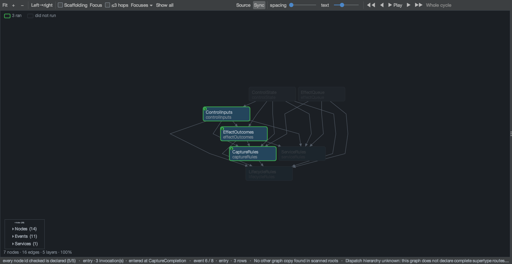
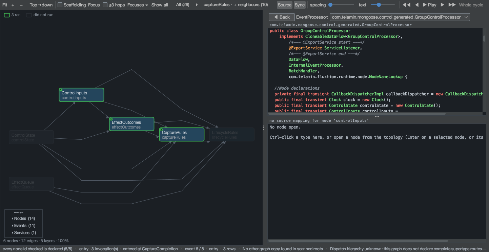

# Case study: diagnosing a late capture completion

An audit capture is requested, then stopped before its open finishes. The open still returns a physical resource.
Should it become the active capture, be forgotten, or be closed? This case follows the answer through Mongoose's
Fluxtion control graph, recorded decisions and effect outcomes.

This is a **successful cancellation path from a synthetic qualification run**, not an incident in production and
not a claim that the whole runtime is proven correct. It demonstrates how to investigate a concrete interleaving.

## Evidence you can open

| Artifact | Scope |
| --- | --- |
| [Analyser investigation bundle](../assets/control-case/mongoose-capture-cancellation.fexp) | Selected audit, generated topology, findings, saved focus and a four-step walk |
| [Browser walkthrough](../assets/control-case/mongoose-capture-cancellation.html) | Captured investigation frames with explanatory callouts |
| [Raw audit excerpt](../assets/control-case/late-capture-excerpt.yaml) | Eight original YAML documents containing requests 472 and 473 |
| [Excerpt provenance](../assets/control-case/excerpt-provenance.json) | Source/excerpt hashes and explicit partial scope |
| [Full qualification archive](../reports/pr76-qualification-2026-10-25/chaos-audit-19796.tar.gz) | Three complete exported group sinks, paired manifests and file verifier |

The source run used runtime commit
[`c7c92da`](https://github.com/telaminai/mongoose/commit/c7c92da8adbe087270e95a29eec51c3fcf159515),
seed **19796**, group **`chaos-g2`**. It ran for 30 seconds with the built-in Chronicle capture backend.
The graph and capture rule source used for these views are unchanged between that runtime and documentation
baseline `4f5851e`; this was checked against git. Graph membership alone would not establish that provenance.

The original group's manifest reports 5,204 YAML documents, zero dropped records and zero sink failures. The
excerpt has **no complete-history claim**. It includes 14 structured control records (`seq` 3136–3149) inside eight
event-cycle documents. Analyser row indexes, YAML document counts and control `seq` values are different quantities.

## 1. State the expected behaviour

`AuditStop` during `Opening` cancels adoption of the pending open. It cannot forcibly cancel arbitrary backend I/O.
If that I/O later returns a resource, the group must retain its identity and request closure rather than install it.
A stop reply can precede physical cleanup.

This selected scenario contains **capture cancellation on one processor generation**. It does not contain processor
replacement. The same identity discipline matters for replacement races, but those require their own evidence.
See [capture ownership](../architecture/sequence-diagrams/audit-capture.md).

## 2. Open the graph and choose the evidence

Open the `.fexp` bundle in the analyser and select the saved walk **Mongoose capture cancellation**. Alternatively,
open the excerpt and the matching
[GroupControlProcessor GraphML](https://github.com/telaminai/mongoose/blob/c7c92da8adbe087270e95a29eec51c3fcf159515/src/main/resources/com/telamin/mongoose/control/generated/GroupControlProcessor.graphml).
The graph declares all five nodes that log in this excerpt. Hide framework scaffolding to see the authored rules.
The bundle contains the log and graph, but not Java source. To inspect source, add `src/main/java` from the matching
checkout as an analyser source root; the screenshots below use the checked source described above.

{ .architecture-image }

The graph shows dependencies; the selected audit shows which nodes logged in that cycle. An unlogged or unshaded
node is not proof that it did not execute. The analyser also reports incomplete dispatch-hierarchy metadata for
this graph; do not infer every possible dispatch route from the visible edges.

## 3. Follow identity and outcomes

| Excerpt row (zero-based) | Control seq | Evidence | Interpretation |
| --- | --- | --- | --- |
| 0 | 3136–3137 | Request 472, generation 110, `auditStartOnStarted`, `472.1 OpenCapture(110)` | The rule decides to open a capture |
| 1 | 3138 | `OpenCapture`, `pending` | Physical I/O has been handed off; recording is not established |
| 2 | 3139–3140 | Request 473, `auditStopCancelsOpen`, `Opening->Off`, `pendingCleanup: 472.1` | Stop cancels adoption while retaining the unresolved operation |
| 3–4 | 3141–3142 | Start reply `REFUSED`; stop reply `APPLIED` | Both callers have final logical outcomes |
| 5 | 3143–3145 | `CaptureOpened`, resource 30; `captureOpenedStale`; `472.3 CloseCapture(110)` | The late resource is routed to cleanup, not installation |
| 6 | 3146 | `CloseCapture`, `pending` | Closure has been requested but is not yet confirmed |
| 7 | 3147–3149 | `CaptureClosed`; close outcome `succeeded`; `captureClosed` | The backend reports closure and the rule clears pending cleanup |

Filtering by name or generation alone can miss completions: not every record repeats those fields. Follow
`rootId`, `causeOp` / `opId` and `resourceId`, and retain the cancelling request's separate root. Here `472.1`
identifies the open, `472.3` its cleanup, and resource **30** connects the physical lifetime.

## 4. Focus the responsible rule

Select `captureRules`, focus its neighbours, and select excerpt row 5. The relevant path is `controlInputs` →
`effectOutcomes` → `captureRules`. Inspect `CaptureRules.onCompletion` and its open-completion handling alongside
the record. Its decision requests `CloseCapture`, rather than an `InstallCapture` effect.

{ .architecture-image }

An LLM can drive the same investigation with MCP verbs. After opening the excerpt and its graph:

```json
{"tool":"analyser_filter","arguments":{"text":"rootId: 472"}}
```

That filter deliberately hides request 473. Clear it to see the cancellation, then focus the late completion:

```json
{"tool":"analyser_filter","arguments":{"text":""}}
{"tool":"analyser_topology","arguments":{"recordIndex":5,"select":"captureRules","scope":"neighbours","focus":true}}
{"tool":"analyser_read","arguments":{"recordIndex":5,"count":1,"fields":["controlInputs.*","effectOutcomes.*","captureRules.*"]}}
{"tool":"analyser_source","arguments":{"fqn":"com.telamin.mongoose.control.node.CaptureRules","method":"onCompletion"}}
```

Here topology indexes address the filtered view, while `read` addresses the loaded log; clearing the filter makes
the excerpt indexes align. `aggregate` can count matching event-cycle documents, but that count is not the number
of requested effects or proof of exactly-once closure. Save findings with `flag` and a report; spotlight captions
are explanatory annotations, not additional evidence.

## 5. Check what the audit cannot establish alone

The trace supports this conclusion: **the rule rejected adoption of a cancelled open and the backend reported a
successful close for resource 30**. It does not independently prove the backend released every operating-system
resource, or that no unrelated capture leaked.

For broader validation, verify the complete YAML and manifest together, check required outcomes and compare them
with resource ownership and callback counters outside the control rules. The stress workload checks remaining
capture ownership, unanswered requests and processor lifecycle counts. A screenshot or a selected excerpt cannot
replace those checks.

Independent review of baseline `4f5851e` found gaps in the invariant validator and scenario oracles, including
premature replies and cleanup deferred until group close. Consequently the original run's “zero violations” is
not proof those defect classes are absent. The file's completeness is a narrower fact than validator adequacy.
This case study remains useful because it cites the actual decisions and outcomes rather than relying on a
blanket pass verdict.

The full export also contains Mongoose `controlFallback` documents. Some analyser views expect Fluxtion
`eventLogRecord` documents and warn about that format. Preserve and inspect fallback records separately with the
Mongoose export/validation tools; do not silently discard them to manufacture a clean result.

## Apply the workflow to other problems

| Symptom | Start with | Then check |
| --- | --- | --- |
| A processor failed to start | Its add request and `BuildAndStart` outcome | Callback error, release, name ownership and final reply |
| A service did not arrive or withdraw | Versioned broadcast and each `DeliverService` outcome | Group acknowledgements, registry instance identity, callback logs and retained ownership |
| A business event produced the wrong output | That processor's own audit and graph | Logged inputs, rule values, sink observations and a supported replay |
| Shutdown remains incomplete | `StopResult`, helper state and resource diagnostics | Pending captures, blocked callbacks and control fallback records |

Control audit records the host's lifecycle decisions. To explain the logic inside a service or business processor,
load that component's own evidence. Correlate across boundaries using identities you deliberately carry; Mongoose
does not create a universal cross-process causal trace.

This is the practical benefit of [using Fluxtion inside Mongoose](../architecture/built-with-fluxtion.md): the runtime's
own control decisions can be investigated with the same tools as an application, while the evidence boundaries
remain explicit.
