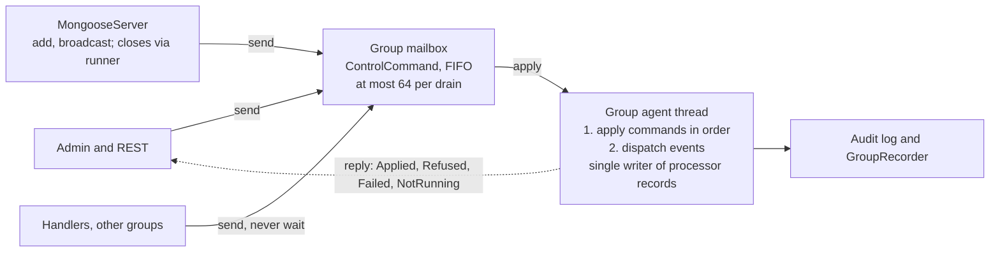

# Mongoose control plane as events — design

Status: proposal, revised 2026-10-24 after an independent review (see the last section). Targets the release after 1.0.33. Code references are to the integration branch at `f54a768` (PR #69).

## Problem

Most of the defects fixed for 1.0.33 share one root cause: a processor's lifecycle state has no single owner. Several components on different threads each keep their own view, and the views drift apart. The fast event path, which runs on one thread with no locks, produced almost none of them.

| Defect | Fixed in | What drifted |
| --- | --- | --- |
| A stop sent while the add was still queued did nothing | #72 | The stop was checked before the queued add had run |
| The stop hook ran twice | integration commit, #72 with #74 | Two components each owned "stopped" |
| Audit captures stayed open after server stop | #65 | Audit lifetime was tracked apart from processor lifetime |
| Server stop refused to close audit captures on groups that had already stopped | integration commit, #65 with #74 | Shutdown asked closed groups to do work |
| A processor's name was released twice in a rare window | known, not fixed | The server's name reservations and the agent's drop path each release the name |
| Timers kept firing into a stopped processor | #72 (#71) | Scheduler bindings outlived the processor |
| A retry re-sent the event to every processor on the queue | #73 (#53) | Delivery was tracked per queue, not per processor |
| An add or remove of a subscriber waited up to 39.9 s | #52 | `publishLock` is an unfair Java monitor shared by the fast path and control calls |
| `runOnAgentThread` race | documented, not fixed | Hand-off to the agent thread plus reads of shared state from the caller |

Four of the 13 PRs needed extra commits on the integration branch just to work together, though none of them had merge conflicts. That coupling is the cost this design aims to remove.

## Goals and non-goals

The goal is one owner per piece of lifecycle state, and that owner is a single thread. Every change to a processor goes through that thread, in order, as a message, and every request gets a truthful answer.

**Goals**

1. Each processor group's agent thread is the only writer of its processors' lifecycle state, including name ownership and audit-capture lifetime.
2. All control requests to a group travel through one ordered mailbox, so a stop can never overtake the add it refers to.
3. Every control call returns a reply future with a definite outcome: applied, refused with a reason, failed, or the group was not running. No request is ever left pending.
4. Applied control is framed in each affected processor's audit log, and a stop is recorded in that processor's replay stream.
5. The fast event path keeps its current cost: no new locks, allocation or branches per event.
6. Public API stays source compatible. Existing `void` methods keep working; methods to be removed are deprecated first.

**What must hold whatever the configuration.** These follow the stability review of PR #69 and are not trade-offs:

- An old stop can never affect a newer processor registered under the same name, and a refused add leaves no reservation behind.
- Nothing reopens after a stop completes. A callback that ignores cancellation may delay shutdown, but stop never reports completion early; it reports what is still running.
- A reply never claims more than happened. `Applied` means the change is complete, not just accepted.

**Non-goals**

- Distribution, clustering or failover. Mongoose stays an in-process runtime.
- A global order across groups. Each processor's consumed order is the evidence; commands to different groups are not ordered against each other.
- Changing how feeds publish into queues. `EventToQueuePublisher` keeps `publishLock` and the #52 fix; feed delivery modes are a separate decision.
- Changing the plugin contract for connectors, services and admin commands.
- Changing Fluxtion's generated dispatch.

## Current control paths

The group already behaves like a mailbox, but it has four of them, and the server keeps state of its own beside them. Code references are to the integration branch at `f54a768`.

`ComposingEventProcessorAgent` has four control queues, all `ManyToOneConcurrentArrayQueue`, and `doWork()` drains them in a fixed order at the start of every duty cycle:

1. `toStopList`, names to stop (`checkForStopped`)
2. `toStartList`, suppliers that build a processor (`checkForAdded`)
3. `servicesToBroadcast`, service register and deregister (`checkForBroadcasts`)
4. `onAgentThread`, arbitrary `Runnable`s handed over by `runOnAgentThread`

The fixed order across queues is what lost a stop sent just after its add (#72). The fix drains `toStartList` before `toStopList`, which patches one pair but leaves the order between the others undefined.

**Who writes lifecycle state today**

| State | Lives in | Written by | Threads |
| --- | --- | --- | --- |
| Server lifecycle (NEW to STOPPED) | `MongooseServer.lifecycleState`, an `AtomicReference` | `start()`, `stop()`, `runOrderedStop()` | caller, or `mongoose-server-stop` |
| Processor name reservations | `MongooseServer.reservedProcessorNames`, a concurrent set | Added by `addEventProcessor` on the caller; removed on build failure, by `processorDropped` on the agent, and by a `runOnAgentThread` task queued by `stopProcessor` | caller and agent |
| Registered processors | `registeredEventProcessors`, a `ConcurrentHashMap` in the group | `startProcessor`, `release`, `onClose` | agent; read from any thread by `registeredProcessors()` |
| Audit capture per processor | `ChronicleAuditCaptureService.sinks` plus `synchronized` and `volatile` fields on each sink | `attach`, `start`, `stop`, `detach`, `stopAll`, using `AgentHandoff` to reach the agent | caller, agent, `mongoose-server-stop` |
| Group closed | `closed`, `agentThread` (`volatile`) | `onStart`, `onClose` | agent; read by callers |

**Where the threads meet**

- `addEventProcessor` and `stopProcessor` return before the group acts. The caller cannot learn whether the add started, failed and was dropped, or never ran.
- Stop is addressed by name. If a name is freed and reused, a stop meant for the old processor can find the new one. The reservation is freed after the stop to avoid that, which is the window where a name can be released twice.
- `runOnAgentThread` runs the work inline on the caller's thread when the group has not started or its thread has died. The same code therefore runs on two different threads depending on timing.
- `onClose` drains `onAgentThread` but not `toStartList` or `toStopList`. A processor added just before close is never built, and its name reservation is never released.
- Audit capture calls `AgentHandoff.submit` and waits up to its apply timeout. Server stop calls `stopAll()` after the groups have closed, so it has to skip the hand-off and forget the sinks first.
- Admin commands that change a processor run as lambdas outside an event cycle, so their audit records are unframed.

## Proposed model

Each group gets one ordered mailbox of control commands, and the group's agent thread is the only code that applies them. Callers send a command and get a reply future back. The server keeps no per-processor state of its own.

Callers on any thread send commands; the group thread applies them in order before dispatching events, and completes each reply.

**One mailbox per group.** The four queues become one `ManyToOneConcurrentArrayQueue<ControlCommand>`. Commands are applied in the order they were accepted, in a drain at the start of each duty cycle, before any event is dispatched. A drain applies at most 64 commands, so a burst of control cannot stall market data.

**Commands.** A sealed `ControlCommand` type with one record per request:

- `Add(name, supplier)` checks the name, then builds, wires and starts a processor.
- `Stop(name, generation?)` stops it and releases everything it holds.
- `Broadcast(service, register)` delivers or withdraws a service.
- `AuditStart(name)` and `AuditStop(name)` start and end an audit capture.
- `Run(task)` keeps `runOnAgentThread` working for plugins during migration. It is deprecated.

Closing a group is not a mailbox command; see Closing below.

**Replies.** Every command carries a future completed exactly once with one of four outcomes:

- `Applied(handle)`, with the processor's name and generation where one applies. Sent only once the change is complete.
- `Refused(reason)`, for example a name already in use, no such processor, or the server is stopping
- `Failed(cause)`, for example `start()` threw and the processor was dropped
- `NotRunning`, when the group is closing, closed or dead

A caller that stops waiting **detaches**: the command still applies and its outcome is logged. Unlike `AgentHandoff`, a timeout never cancels a command, so a slow stop is never silently dropped.

**The group owns names.** Each group keeps a plain `HashMap` from name to a processor record, written only by its agent thread. The record holds the processor, a generation number that increases with every add, its subscriptions and its audit-capture state. The server's `reservedProcessorNames` set is removed. The name is checked when the `Add` is applied, on the agent thread, so there is no window between checking a name and queuing its start; that window is the race left in 1.0.33's F4 fix. A name is freed in the same step that removes the record, so it can be released only once. Other threads read a snapshot that the agent thread publishes after each change.

**Group states.** **New** (thread not started), **Starting** (inside `onStart`), **Running**, **Closing**, **Closed**, and **Dead** (the thread exited without `onClose`, for example an `Error` thrown from `onStart`, which Agrona rethrows before calling `onClose`). A command sent to a New group waits and is applied in `onStart`. A command sent to a Closing, Closed or Dead group completes `NotRunning` at once. Group code never runs on a caller's thread, with one exception: Agrona runs `onClose` for a group that never started on the thread that closes it.

**Closing.** Close stays driven by the runner, as today: the server sets the group's `closing` flag, then calls `AgentRunner.close()`. From the moment the flag is set, new commands complete `NotRunning`, and senders waiting on a full mailbox re-check the flag and leave. In `onClose` the group:

1. Sets `closed`, then drains the mailbox until `isEmpty()` reports no claimed slots, not just until `poll()` returns null. Agrona's drain stops at a slot a sender has claimed but not yet written, so stopping at null can miss a later sender's command.
2. Completes each queued `Add` as `NotRunning` without running its supplier, and each other command as `NotRunning`, except a `Stop` of a running processor, which completes `Applied` after step 3.
3. Stops every processor in add order, ending each one's audit capture, then replies.

The server bounds its wait on each group. A group that does not close in time is reported as still running, never as stopped. `ChronicleAuditCaptureService.stopAll()` is deprecated: each group closes its own captures.

**Dead groups.** A sender checks that the runner's thread is alive before offering. Once the server sees a group's thread has terminated without closing, it is the only remaining consumer of that mailbox, so it drains it and completes every queued command `NotRunning`.

**Event path unchanged.** `doWork()` checks one `isEmpty()` where it checks four queues today. Dispatch is untouched, and rule 5 is never implemented as a per-event check.

## State machine

Because one thread applies each command whole, a processor has only two states that anyone outside can observe: absent or running. Building and starting happen inside one apply step. The table covers every command in every group state.

| Command | New or Starting | Running, name absent | Running, name present | Closing, Closed or Dead |
| --- | --- | --- | --- | --- |
| `Add(name)` | Queued; applied in order in `onStart`. Boot fail-fast applies only to adds accepted before `onStart` began; an add sent during `onStart`, for example from a processor's own `start()`, is isolated like a runtime add | Build and start. Success: `Applied(name, gen)`. A throw: record removed, name freed, `Failed(cause)` | `Refused("name in use")`. Nothing changes | `NotRunning`; supplier never runs |
| `Stop(name)` | Queued; applied in order, so it stops a processor added before it. A stop sent before its add now loses (release note) | `Refused("no such processor")` | Stop, tear down, cancel timers, release subscriptions, replay bindings and audit capture; free name; then `Applied(name, gen)`. A throw in `stop()` or `tearDown()` is reported and the release still completes | `Applied` after the group's own close stops it, if the processor was running; else `NotRunning` |
| `Stop(name)` from that processor's own `stop()` | n/a | `Applied`; the release already in progress satisfies it | as left | as left |
| `Stop(name, gen)` | As above | `Refused("no such processor")` | As `Stop(name)` when `gen` matches; `Refused("generation changed")` when the name belongs to a later add | As `Stop(name)` |
| `Broadcast(service)` | Queued | Recorded for later adds; `Applied` | Delivered once to each running processor. A processor whose `@ServiceRegistered` throws is reported and counted as delivered; the reply is `Applied` with the failures listed | `NotRunning` |
| `AuditStart(name)` | Queued | `Refused("no such processor")` | Install the capture listener. Already recording: `Applied`, no change | `NotRunning` |
| `AuditStop(name)` | Queued | `Refused("no such processor")` | Restore the configured listener; hand the queue to be closed. Not recording: `Applied`, no change | `NotRunning` |

**Timing and edge cases**

- **Commands from a handler during dispatch** are applied at the start of the next duty cycle, because the drain runs before dispatch. A command sent by an apply step itself, such as an add from a processor's `start()`, can be applied later in the same drain if the 64-command budget allows.
- **A full mailbox on the group's own thread** completes the future `Refused("mailbox full")` instead of throwing, so the failure never lands inside dispatch and the event retry policy.
- **Adds after server stop has begun** are refused by the server, `Refused("server stopping")`, and never create a group.

The cases that broke in 1.0.33 each map to one row: a stop just after its add (#72) is applied in order; a stale stop is refused by generation; a name is freed only when its record leaves the map, once; and an audit capture ends with its processor record, including at close (#65).

## Rules

These are the contract. Each one gets a named test (see Test plan), and the javadoc of the public methods states them.

1. **Single writer.** Only a group's agent thread changes that group's processor records, names, subscriptions, timers and audit-capture state. The one exception is `onClose` of a group that never started, which Agrona runs on the closing thread when no agent thread exists.
2. **Order.** Commands to one group apply in the order the mailbox accepted them. Commands to different groups have no order between them.
3. **One outcome.** Every accepted command completes its future exactly once: `Applied`, `Refused`, `Failed` or `NotRunning`. This holds for closing and dead groups, and for apply steps that throw.
4. **Control before events.** Commands apply in the drain at the start of a duty cycle, never during dispatch. A command sent during dispatch applies at the next cycle.
5. **Delivery.** Each event is delivered at least once to each processor that was running when it was dequeued. A retry goes only to the processor that threw (from #73). This is not exactly-once for external effects; applications that need it use idempotency keys or reconciliation.
6. **Fatal errors.** A `VirtualMachineError` in an apply step completes that command `Failed(cause)` in a `finally`, then is rethrown to the agent's error handler. It is never retried or swallowed.
7. **Names.** A name is checked and taken when its `Add` applies, on the agent thread, and freed when its record is released by stop, failed start or close. An `Add` applied after the `Stop` of the same name succeeds.
8. **Stop releases everything.** Stopping a processor runs `stop()` then `tearDown()`, cancels its timers, releases its subscriptions and replay bindings, ends its audit capture and frees its name. Each step runs even if an earlier one throws.
9. **Truthful shutdown.** Server stop drains event sources, closes each processor group with a bounded wait, then stops service groups. It returns a result that names any group still running; it never reports stopped while a group is.
10. **No waiting on an agent thread.** Code on an agent thread never blocks on a reply. Methods called from an agent thread return without waiting.
11. **Timeouts detach.** A caller that stops waiting leaves the command to apply; a timeout never cancels a command.
12. **Capture lifetime.** An audit capture never outlives its processor record.

## Threading and API

New methods return `CompletionStage<ControlReply>`. Existing `void` methods keep their signatures and wait for the reply only off agent threads, and a timeout detaches rather than cancels.

| Method | Returns | Off an agent thread | On an agent thread |
| --- | --- | --- | --- |
| `addEventProcessor(...)` (existing) | `void` | Waits up to the control timeout; throws `IllegalArgumentException` on `Refused`, `ProcessorStartException` on `Failed`. On timeout logs and returns; the add still applies | Queues and returns; a duplicate surfaces as a logged `Refused` |
| `addProcessor(...)` (new) | `CompletionStage<ControlReply>` | Never waits | Never waits |
| `stopProcessor(group, name)` (existing) | `void` | Waits up to the control timeout; logs a `Refused`. On timeout the stop still applies | Queues and returns |
| `stopProcessor(handle)` (new) | `CompletionStage<ControlReply>` | Never waits | Never waits |
| `registerService` / `removeService` (existing) | `void` | Sends a `Broadcast` to every group and waits for all replies, up to the control timeout | Sends and returns. Matters at boot, where `registerAgentService` runs on the service-agent thread |
| Admin `audit.start`, `audit.stop`, `stopProcessors` | admin reply | Waits at most 1 s, because the transport thread runs them inline; otherwise replies "pending" and logs the outcome | Not called from agent threads |
| `runOnAgentThread(task)` (existing, deprecated) | `void` | Queues a `Run`; throws `IllegalStateException` on `NotRunning` | Runs inline on its own group's thread, as today |

**Sending, and why nothing is lost.** A sender checks the group is neither closing nor dead, offers the command, then re-reads the `closing` flag. If the flag is now set, it claims the command and completes it `NotRunning`. The agent claims each command it applies. Whichever side claims first completes the future. The agent's final drain runs until `isEmpty()` reports no claimed slots, so a command whose sender was preempted between claiming a slot and writing it is still found. The tail compare-and-set in `offer` is a full barrier, which makes the offer-then-re-read order safe.

**Full mailbox.** Off the group's thread, sending backs off for up to the control timeout of 10 s, re-checking `closing` on every pass. On the group's own thread it completes `Refused("mailbox full")` at once.

**Before the group starts.** A `void` add to a group whose thread has not started cannot wait, because nothing would answer. It queues the `Add` and returns; a refusal or failure surfaces when the group starts, through the boot failure policy from #66. Duplicate names in configuration are caught when it loads: YAML parsing rejects duplicate keys, which today collapse silently in `EventProcessorGroupConfig.eventHandlers`, a `HashMap`, and the loader rejects a name repeated across two entries with the same `agentName`.

**Reads.** `registeredProcessors()` and `isProcessorRegistered()` read an immutable snapshot that the agent thread replaces after each change. They never block and may lag by one apply step.

## Audit and replay

Control is audited and replayed per processor, matching the runtime's deterministic boundary: each processor's consumed order is the evidence, and there is no group-wide sequence to place control in.

**Audit.** A framed record can only come from the processor's own event cycle; a record made outside it and pushed through its listener is exactly today's unframed admin record. So applying a command dispatches a small control event into each affected processor: after `start()` for an `Add`, and before `stop()` for a `Stop`. It costs one event cycle per command per processor, which is negligible for control.

**Replay.** The replay store is per processor (`ReplayStore.append(processor, entry)`), and `GroupReplayer` advances each processor's cursor independently. A `Stop` is recorded as the terminal entry of that processor's stream, and replay ends the processor there. `Add`, `Broadcast` and audit commands are not recorded: an `Add` cannot be placed against other processors' inputs, a replayed `Broadcast` would deliver a service twice, and replaying `AuditStart` would open files. A replay of a processor added at runtime starts at its first recorded entry and says so.

## Option: the control plane as a Fluxtion processor

Recommended, after PR 1. Each group's control logic becomes a generated Fluxtion processor. Mongoose then runs its own control plane on the same machinery it offers users, and its decisions appear in an audit log the analyser can read.

**Shape.** The control processor makes decisions; the group applies the effects. Splitting them keeps file and processor I/O out of the processor and keeps its handlers deterministic.

1. The mailbox drain feeds each `ControlCommand` into the group's control processor as an event.
2. Its nodes hold the name registry, generations, each processor's lifecycle state and each capture's state. They decide the transition and emit effects: build and start, release, install or remove a capture, reply.
3. The group applies the effects, then feeds the outcome back as an event (`Started`, `StartFailed`, `Released`), and the processor decides the reply.

**What it buys.**

- Every control decision is a framed record in the control processor's audit log, with the node that made it.
- Recording the control processor's inputs gives the group-level control journal the review found missing. Replaying it reproduces the decisions exactly, though not the data processors' effects.
- The state machine is a Fluxtion graph, so the analyser can show it, and the rules can be tested by firing events at the real processor.

**Costs and open points.**

- Mongoose depends only on `fluxtion-runtime` today. The control processor must be generated ahead of time at Mongoose's build, which adds the Fluxtion compiler as a build-time dependency only. Interpreted mode is ruled out, because it loses labelled source and determinism.
- It is created with its group and never added or stopped through the mailbox; it has no subscriptions and is invisible to `registeredProcessors()`.
- It must read time only through Fluxtion's clock, so replay is deterministic.
- It adds one event cycle per command. That is negligible for control, and the empty-mailbox check on the fast path is unchanged.

## Migration plan

Seven stacked PRs, starting after 1.0.33 ships. Each one is releasable alone and keeps the public API source compatible. The F4 race found in review of #69 is fixed in 1.0.33 itself and is not part of this plan.

1. **One mailbox and the close policy.** Replace the four queues with one `ControlCommand` mailbox and internal futures. `onClose` drains until empty and completes queued commands `NotRunning`, without building queued adds. Add the `closing` flag, the dead-group drain, and the re-check of `closing` in the full-mailbox backoff. Behaviour changes, for the release notes: commands apply strictly in order, and a stop sent before its add now loses.
2. **Reply API.** Add `addProcessor` and `stopProcessor(handle)`. The existing `void` methods wait off agent threads, and a timeout detaches. Admin commands wait at most 1 s. The server refuses adds once stopping.
3. **Names move into the group.** Processor records with generations, the read snapshot, and the duplicate-name checks at config load. Delete `reservedProcessorNames` and the stop-time release task. This comes after PR 2 so a duplicate add can still throw, which four `LifecycleRacesTest` cases and the boot failure on duplicate config names rely on.
4. **Control logic as a Fluxtion processor** (the option above). Replaces the hand-written apply step with the generated control processor and its effects.
5. **Audit capture as commands.** Capture state moves into the processor record. Chronicle queues open and close on a helper thread, and the agent completes the future once the helper hands back. `stopAll()` and `attach(..., Executor)` are deprecated, not removed.
6. **Service groups.** `ComposingServiceAgent`'s three one-to-one queues, written by many producers today, move to the same mailbox model.
7. **Framed audit of control and `Stop` markers in replay.**

PRs 1 to 3 carry most of the risk reduction. PR 4 can be dropped without affecting the others.

## Test plan

Each rule gets one test named after it, written before the PR that makes it pass. The 1.0.33 regression tests stay and must pass unchanged at every step.

| Rule | Test | PR |
| --- | --- | --- |
| 1 Single writer | Every record, name and capture change asserts it runs on the group's thread (a check enabled in tests) | 3 |
| 2 Order | 10,000 interleaved add, stop and re-add of one name from 4 threads; the final state matches applying the accepted order | 1 |
| 3 One outcome | Commands sent while the group closes, including a sender held between claiming and writing a slot; every future completes once | 1 |
| 3 One outcome, dead group | `onStart` throws an `Error`; every queued and later command completes `NotRunning` | 1 |
| 4 Control before events | A handler stops its own processor; the stop applies at the next cycle and no event reaches it after | 1 |
| 5 Delivery | Existing #73 tests | 1.0.33 |
| 6 Fatal errors | A `VirtualMachineError` from `start()` and from `stop()`: the command completes `Failed`, the error reaches the handler | 1 |
| 7 Names | Stop then re-add with no wait succeeds; two concurrent adds of one name give one `Applied` and one `Refused`; duplicate names in YAML, within one entry and across entries, fail at load | 3 |
| 8 Stop releases everything | Timers, subscriptions, replay bindings, capture and name all released when `stop()` and `tearDown()` both throw | 3 |
| 9 Truthful shutdown | A group that will not close in time is reported as running, and stop does not report stopped | 1 |
| 10 No waiting on an agent thread | A handler calls the `void` add and stop on another group; nothing blocks. Admin stop replies within 1 s on a busy group | 2 |
| 11 Timeouts detach | A `void` stop times out on a busy group; the processor is still stopped afterwards | 2 |
| 12 Capture lifetime | Capture recording when its processor stops, is dropped, or the server stops; queue closed each time | 5 |

**Regression tests to keep:** `ProcessorStopReleaseTest`, `ProcessorStartFailureTest`, `RetryOnlyTheFailedProcessorTest`, `ServerStopEndsAuditCaptureTest`, `LifecycleRacesTest`, `AuditControlOnAgentThreadTest`, `IntegrationReleaseRegressionTest`, and `EventToQueuePublisher` `publishersInALoopDoNotStarveARemoveOrAnAdd`.

**Latency check.** A JMH run of the duty cycle with an empty mailbox, before and after PR 1, to confirm the fast path is no slower.

## Risks and open questions

The biggest risk is still that existing `void` callers start waiting. The open questions are smaller after review.

**Risks**

- **Callers that start waiting.** `addEventProcessor`, `stopProcessor`, `registerService` and `removeService` will wait off agent threads, up to 10 s. A caller holding a lock the group needs could deadlock until the timeout. Mitigation: timeouts detach, a release note, and a server option to keep fire-and-forget for one release.
- **Interrupted close.** After a 5 s join, Agrona interrupts the agent thread and `onClose` runs interrupted. Chronicle queue closes can then throw `ClosedByInterruptException`; they are reported, and the capture is marked as not closed cleanly.
- **A stop that waits on a startup step.** From 1.0.33 (F1), server stop waits for an in-progress startup step and may call a service's `stop()` twice. This design keeps that and reports a group that cannot close in time instead of hanging.
- **Control latency.** Commands wait for the next duty cycle, at most 64 per drain. A burst of 1,000 adds takes 16 cycles.
- **Plugins using `runOnAgentThread`.** It stays, deprecated, until mongoose-plugins move off it.
- **Feed publishing is still a lock boundary.** `publishLock` remains, with the #52 fix. Delivery modes for full queues (drop after a bounded wait today, logged and counted) are a separate decision, raised by the stability review.

**Open questions**

- [ ] Should a service `Broadcast` across several groups be all-or-nothing? This design applies it per group and reports each group's outcome.
- [ ] Keep `Stop(name)` without a generation as the default, or require a handle in the new API?
- [ ] Is 64 commands per drain the right bound, and should it be configurable per group?
- [ ] For the control processor: is generated source checked in, or generated at each build?
- [ ] What does server stop return to say a group is still running: a result object, or an exception naming the groups?

## Independent review

The review was done by Fable 5.1 working from the code at `f54a768`, without the author's reasoning. Its verdict: the direction is right and it removes the #72 and double-release class of bug rather than moving it, but it is **not ready to implement**. Three blockers must be fixed before PR 1, and PR 6 needs a redesign. All findings are accepted, and the sections above were revised to match on 2026-10-24.

| # | Severity | Finding | Response |
| --- | --- | --- | --- |
| 1 | Blocker | The never-lose protocol has a hole. Agrona's `drain` stops at the first slot a sender has claimed but not yet written, so a later sender's command can be missed by the final drain and never claimed back. Senders parked on a full mailbox never check `closed` | Accept. The final drain loops until `isEmpty()`, which covers claimed-but-unwritten slots. The full-mailbox backoff re-checks `closed` and completes `NotRunning` |
| 2 | Blocker | It is unclear who ends the agent thread when `Close` is a mailbox command. `AgentRunner.close()` has no time bound, so rule 9's drain timeout cannot be met through it. `onClose` may run on an interrupted thread | Accept option (a): close stays runner-driven, `Close` only carries the reply, and `onClose` drains to empty. Bound the wait on our side and treat interrupted Chronicle closes as reported, not fatal |
| 3 | Blocker | An `Error` thrown from `onStart` skips `onClose`, so the mailbox is never drained and every future stays pending. A fatal JVM error in an apply step also conflicts with rule 3 | Accept. Add a Dead group state; senders check the runner is alive. Each apply step uses try/finally to complete `Failed(cause)`, then rethrows the fatal error |
| 4 | Major | PR 2 removes name reservations before PR 3 adds replies, breaking four `LifecycleRacesTest` cases and duplicate-name boot failure. YAML is not checked for duplicates today: `eventHandlers` is a `HashMap` (`EventProcessorGroupConfig.java:40`). PR 1 is not behaviour-neutral at close | Accept. Swap PR 2 and PR 3, add a real config-load duplicate check, and move the `NotRunning`-at-close policy into PR 1 |
| 5 | Major | Framed audit of control is unspecified. A record made outside the processor reproduces today's unframed records | Accept. Use a control event dispatched through the processor's own cycle, after `start()` for `Add` and before `stop()` for `Stop` |
| 6 | Major | The replay store is per processor (`ReplayStore.java:9-12`), with no group-level sequence to place control in | Accept. Shrink PR 6 to per-processor `Stop` markers; a group-level control journal becomes separate future work |
| 7 | Major | If the `void` methods inherit `AgentHandoff`'s cancel on timeout, a slow stop is silently dropped | Accept. A timeout detaches the caller; the command still applies. Never cancel a `Stop` |
| 8 | Major | Service groups have the same many-producer problem on one-to-one queues. `registerService` is called from agent threads at boot | Accept. Add service groups to scope as a later PR, and add `registerService` and `removeService` to the threading table |
| 9 | Minor | `Close` needs a path past a full mailbox. Adds while the server is stopping are queued forever. Removing `stopAll()` breaks source compatibility. Admin `stopProcessors` blocks the transport thread (`MongooseServerAdmin.java:288-292`) | Accept all. Priority close flag; refuse adds at the server once stopping; deprecate `stopAll()` instead of removing it; admin calls do not wait |

**State machine cells to add:** a Dead group; commands sent while `onStart` is draining (an `Add` from a processor's own `start()` should be isolated, not fail the boot); same-cycle versus next-cycle for a handler's own commands; `Stop` from a processor's own `stop()` returns `Applied`; a `Stop` sent before its `Add` now loses (release note); a `Broadcast` whose `@ServiceRegistered` throws; a full mailbox on the group's own thread during dispatch; server state crossed with group state.

**Next step:** a second independent review of the revised design before PR 1.
