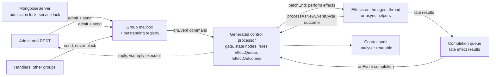

# Mongoose control plane as events — design

Status: proposal, revision 4, 2026-10-24. Responds to four reviews and three follow-ups on PR #75 (see [Review responses](#review-responses)). Targets the release after 1.0.33. Mongoose code references are to `integration/next-release` at `74ad868` unless stated; review citations at `ad07abc` were re-checked there. Analyser references are to `telaminai/fluxtionauditlog-analyser` at `985ea71`.

## Summary

Each processor group gets one ordered control mailbox and a **generated Fluxtion control processor** that decides every lifecycle transition. Effects run at Fluxtion's own transaction boundary, `batchEnd()`, after the decision's audit record has been written, and their outcomes come back as audited events of their own. This is the model the analyser's session controller already uses in production, and this design adopts it, adapting what Agrona concurrency and shutdown require.

The control audit is a primary goal. It supports an LLM-assisted validation loop: agree intended behaviour, generate and execute scenarios with project tools, inspect the evidence through the analyser's existing MCP verbs, identify violations against independently written invariants, and produce regression tests and reviewable explanations.

What revision 3 changes:

- The control processor is generated from the first PR; effects use `@OnBatchEnd` and `processAsNewEventCycle`, as in the analyser, not a hand-rolled loop.
- Every command, group, registration generation and effect operation has an identity carried through the audit; pending and final outcomes are distinct.
- Name admission stays a send-time compare-and-set, so duplicates still throw at once; every transition is decided on the agent thread.
- Terminal admission no longer relies on the final drain: an outstanding-command registry is swept when a group closes or dies.
- Shutdown has one end-to-end deadline, is serialised against admission, and reports what is still running.
- Audit capture opens asynchronously with explicit `Opening` and `Closing` capture states; a stale open is detected by identity and compensated by closing it.
- Matching graph, source and audit evidence, investigable through existing MCP verbs, is an acceptance criterion.
- Diagnostic audit, invariant validation and deterministic replay are separate capabilities with separate promises, and the audit's coverage limits are stated.
- The authoring and investigation workflow has been tried end to end on a small lifecycle lab (see [Field evidence](#field-evidence-the-authoring-and-investigation-experiment)). It demonstrates the authoring and investigation benefit; it does not test this design's concurrency, shutdown or replay guarantees.

## Design objective: an inspectable control plane

The control plane should be something you can interrogate, not just trust. The loop:

**Agree intended behaviour → generate and execute scenarios → inspect audit evidence → identify violations → write regression tests and explanations → revise → repeat.**

Fluxtion fits deliberately. An early customised Fluxtion was a state-machine generator: an event arrives, the current state determines permitted transitions, and the transition requests effects. A generated control processor means every decision is made by a named node in a generated graph, the graph *is* the transition specification, and its audit uses the format the analyser already reads.

**Two kinds of tool, kept separate** (as the analyser's authoring guide does, `docs/site/spring-authoring.md`, "One conversation, two workspaces"):

| Workspace | Tools | Does |
| --- | --- | --- |
| Project | The LLM's own filesystem, shell and build tools; Maven; the scenario harness | Edits the control processor's builder graph, generates it, runs scenarios and tests, exports audit logs |
| Analyser | MCP verbs derived from `VerbSchemas` (`McpTools`) | Presents and interrogates evidence: `context`, `open`, `read`, `aggregate`, `series`, `topology`, `source`, `coverage`, `graph`, `flag`, `spotlight`, `report`, `walk` |

The MCP verbs do not compile, run scenarios or deploy. The harness does not interpret evidence.

**Three capabilities, three promises:**

| Capability | Question | Promise | Not promised |
| --- | --- | --- | --- |
| Diagnostic audit | What happened, in what order, why? | Every control input, decision, effect request, pending and final outcome, and reply is recorded with identities and causal links, or the record says it is incomplete | That the behaviour was correct |
| Invariant validation | Was what happened allowed? | Evidence is checked against invariants written independently of the implementation | Completeness of the invariants; correctness for scenarios not run |
| Deterministic replay | Do the same inputs give the same decisions? | Replaying recorded control inputs and recorded effect outcomes reproduces the control processor's decisions | That effects are reproduced; that recording graph inputs captures every effect |

Intended behaviour lives in this document's rules and invariants. Observed behaviour lives in the audit. Tests assert the former against the latter; the audit is never its own oracle.

## Reference: the analyser's session controller

The analyser already runs a generated Fluxtion state machine for its own session lifecycle, with a decision → audit → effect → audited-outcome model. This design reuses its patterns where they hold and says where Mongoose must differ.

**What the analyser does** (verified in source at `985ea71`):

- `SessionDriver` confines dispatch to one designated thread, throws a `ProtocolViolation` on wrong-thread or nested submission, stamps each request with an `opId`, and runs one operation to completion: `onEvent(fact)`, then `batchEnd()` repeatedly while effects are pending, bounded at 64 rounds, after which a runaway is a `ProtocolViolation` naming the effect.
- `EffectQueue` collects effect requests during dispatch and performs them in an `@OnBatchEnd` method. Each result is re-dispatched with `processAsNewEventCycle`, which, because `batchEnd()` has set `processing = true`, queues it to the back of the callback stack. Each result is then dispatched after the batch's own `afterEvent()`, with a complete record of its own.
- The generated `batchEnd()` sets `processing = true` with no `try`/`finally`, so `EffectQueue` catches every exception from an effect, turns it into `EffectFailed`, and stashes protocol violations for the driver to rethrow after `batchEnd()` returns.
- `EffectOutcomes` writes every outcome under one shape (`effect`, `success`, `opId`, `stale`, `reason`), including outcomes the gate refused as stale, and a `Pending` answer.
- `OperationGate` sits upstream of every state node and refuses stale results: a newer request of the same kind supersedes an outstanding asynchronous open, whose late result is then recorded with `stale=true` and changes nothing (`AsyncOpenReplayTest`: `aSupersededLoadIsRefused`, `aCloseOfTheLogSupersedesAPendingOpen`).
- `SessionAuditSink` is attached before `init()` (measured: attaching after leaks records to stdout), keeps bounded rings that count what they drop, counts sink failures instead of throwing, reports `isComplete() == false` when anything was lost, and exports a snapshot the analyser reopens one record per dispatch (`SessionAuditRecordTest`).

**Verified execution semantics.** In the Fluxtion code generator (`fluxtion-generator-core`, develop branch, 1.0.80-SNAPSHOT):

- The Java template's `batchEnd()` is `auditEvent(BatchEnd); processing = true; <@OnBatchEnd methods>; afterEvent(); callbackDispatcher.dispatchQueuedCallbacks(); processing = false;`, with no `try`/`finally`.
- The generated `onEvent` queues an event that arrives while `processing` is set **only when the generator option `supportReentrancy` is on** (`JavaSourceGenerator.buildProcessEventBody`). With it off, such an event throws. The generated `onEvent` has no `try`/`finally` either (as `DefaultEventProcessor.onEvent` at v1.1.0), so any throw during dispatch leaves `processing` set and the processor wedged.
- `runInEventCycle(auditEvent, action)` does have `try`/`finally` (`DefaultEventProcessor`, v1.1.0).
- In fluxtion-runtime, `CallbackDispatcherImpl.processAsNewEventCycle` is `eventProcessor.onEvent(event)`.

**Version pairing.** Compiler tags `v1.0.72`–`v1.0.75` pair with runtime 1.0.16, `v1.0.76` with 1.1.0, and `v1.0.77`–`v1.0.79` and develop with 1.1.1. Mongoose is on runtime 1.1.0; the analyser pins runtime 1.0.16 with builder 1.0.71. The semantics above were checked on develop, so they hold for the 1.1.1 line, not necessarily for 1.0.76. This is decision [D6](#decisions-needed), and it must be settled before PR 1. Whatever is chosen, PR 1 adds tests asserting the emitted `batchEnd()` and `onEvent` shapes and that `supportReentrancy` is on for the control processor.

**What transfers, and what differs:**

| Pattern | Analyser | Mongoose |
| --- | --- | --- |
| Designated thread | The Swing event thread, for the life of the app | The group's agent thread; work from other threads arrives only through the mailbox, never by calling the processor |
| Single operation in flight | Enforced by `submit` re-entry guard | The drain applies one command at a time to completion, so the property holds per group; a nested submit from an effect is a protocol violation, as in the analyser |
| Effects at `batchEnd()`, outcomes via `processAsNewEventCycle` | Yes | Same. Effects include user code (`start()`, `stop()`), which may block or throw anything |
| No throw out of `batchEnd()` or `onEvent` | Catches `Exception` around each effect; the re-dispatch call itself (`processAsNewEventCycle`) is outside that `try` | Catches `Throwable` short of `VirtualMachineError` around each effect **and** around the re-dispatch; a `VirtualMachineError` is stashed and the group goes Dead after `batchEnd()` returns. A throw from a rule during `onEvent` cannot be caught without leaving `processing` set, so it also makes the group Dead |
| Bounded settlement | 64 rounds, then `ProtocolViolation` | Same bound; the command completes `Failed` and an `Anomaly` is recorded |
| Stale results | Latest request of a kind supersedes; one asynchronous boundary | Many registrations and several asynchronous effects at once, so staleness is judged by **registration generation and operation id**, not "latest request" |
| Stale resource | A superseded load is discarded | A superseded open holds a file: it must be **compensated** by a `CloseCapture` effect, and its closure recorded |
| Pending | Recorded as `success=true`, `reason=pending` | A distinct outcome kind `pending`, never counted as final |
| Marshalling late results | `post()` on the designated thread | An unbounded completion queue drained with the mailbox, so a full mailbox can never refuse a completion |
| Lifetime | The driver lives as long as the app | Groups close and can die: terminal admission, sweeps and server cleanup |
| Generator options | Re-entrancy on (the analyser relies on it) | Must be asserted on for the control processor; with it off, the re-dispatch throws |
| Audit sink | Bounded ring, counted drops and failures, export to analyser YAML | Same, plus `seq` numbers so a gap is detectable per group |

## Field evidence: the authoring and investigation experiment

A hands-on experiment, [reported on PR #75](https://github.com/telaminai/mongoose/pull/75#issuecomment-6386919320), used the Audit analyser bundle template and its Spring add-a-node authoring skill. One agent (GPT-6.1) built a small lifecycle model; a separate reviewing agent inspected its tests and investigated the hosted run through the analyser's MCP verbs.

**What was built.** A Spring-defined graph, `allocationBoundary → lifecyclePolicy → simulatedEffects → effectEvidence`, modelling one active resource slot. Scripted completions stood in for external open operations. A fake adapter kept its own ledgers of handle existence, ownership and close counts, independently of the audit text. A successful completion allocated its simulated handle before the policy decided to adopt or dispose of it.

**Reported results** (from the comment; the artifacts are local and not published):

| Check | Result |
| --- | --- |
| Tests | 7 passed (6 lifecycle tests through the generated processor, plus the graph test); no failures or skips |
| Hosted run | 13 scripted commands, 31 audit records, clean stop; 13 command cycles, 11 with effect and outcome evidence |
| Late completion | Operation 201 for generation 2 arrived while generation 3 was ready; adoption refused; the old handle closed once; the replacement stayed ready with one live, owned handle. Tests asserted the close count and ownership from the ledger |
| Stale stop and duplicate completion | No downstream effect in the audit, and tests asserted unchanged invocation counters rather than inferring non-execution from missing records |
| Final accounting | 3 allocations, 3 closes, 0 live and 0 owned handles; MCP series queries found `allocations - closes - live = 0` and `live - owned = 0` across all 11 effect outcomes |
| Coverage | All 4 lab nodes logged; whole-graph coverage 4/7 because three template nodes were not exercised. Observability information, not state-machine coverage |

**What it demonstrates**, and this design adopts:

- **Explicit, authored structure.** A Spring XML graph gave the LLM something concrete to edit; generation made it executable without hand-editing generated source.
- **Decisions connected to actual outcomes.** The audit recorded what the policy decided and what the effects actually did, as separate records.
- **Investigation another person can follow.** Through MCP the reviewer ran queries, located and inspected records, checked accounting expressions, and preserved the result as flags, a chart, a report, a four-step walkthrough and an evidence bundle. In the experiment the follower was a second LLM agent, not a person; this design adds human sign-off to the acceptance criterion.
- **Assertions against resource state, not narration.** Tests checked independent ledgers (allocations, closes, ownership, invocation counts). The audit was used to explain, and the ledgers to judge.

**Friction it found**, now addressed in this design: a domain event named `LifecycleEvent` collided in generated Java with the runtime's `Lifecycle.LifecycleEvent` (see [Risks](#risks) for naming rules); and a report used a series-section shape that the PDF marked "NOT RENDERED", caught only by visual review (the [workflow](#development-workflow) now includes rendering checks).

**What it does not establish.** Resources were simulated, ordering was scripted, effects ran as ordinary graph triggers (not at `batchEnd()`), and the template pinned Fluxtion 1.0.79 with Mongoose 1.0.32, not this design or the 1.0.33 candidate. It did not test the mailbox protocol, agent death, shutdown bounds, cleanup-failure behaviour, `batchEnd()` publication ordering, deterministic replay or performance. Its deduplication ledgers had no eviction policy. It is evidence for the authoring and investigation workflow, not a conformance test of this protocol; the blockers in [Review 3](#review-3-pr-75-independent-review) are resolved by the protocols in this document and must be proved by their own adversarial tests.

## Problem

Most of the defects fixed for 1.0.33 share one root cause: a processor's lifecycle state has no single owner. Several components on different threads each keep their own view, and the views drift apart. The fast event path, which runs on one thread with no locks, produced almost none of them.

| Defect | Fixed in | What drifted |
| --- | --- | --- |
| A stop sent while the add was still queued did nothing | #72 | The stop was checked before the queued add had run |
| The stop hook ran twice | integration commit, #72 with #74 | Two components each owned "stopped" |
| Audit captures stayed open after server stop | #65 | Audit lifetime was tracked apart from processor lifetime |
| A stop consumed before its add was queued let the add run unreserved | `ad07abc`, `a92e864` | Admission and the start were two steps on two threads |
| Two first adds to a new group both started its thread | `74ad868` | Thread start had two owners; Agrona's losing `run()` marks the runner closed |
| Timers kept firing into a stopped processor | #72 (#71) | Scheduler bindings outlived the processor |
| A retry re-sent the event to every processor on the queue | #73 (#53) | Delivery was tracked per queue, not per processor |
| An add or remove of a subscriber waited up to 39.9 s | #52 | `publishLock` is an unfair monitor shared by the fast path and control calls |

Several of the later #69 fixes were found only by reasoning about interleavings by hand. Interleavings should instead be generated, executed and checked against evidence.

## Goals and non-goals

**Goals**

1. Every lifecycle transition for a group's processors is decided by that group's generated control processor, on its agent thread.
2. All control requests to a group travel through one ordered mailbox.
3. Every control request gets exactly one final reply, including when a group closes or dies.
4. The control audit records inputs, identities, decisions, effect requests, pending and final outcomes, and replies, causally linked, and states its own incompleteness.
5. Invariants are written independently of the implementation and checked against audit evidence.
6. A lifecycle regression yields matching graph, source and audit evidence that the analyser's existing verbs can investigate.
7. Shutdown has an end-to-end bound and reports truthfully what is still running.
8. The fast event path keeps its current cost.
9. Each migration PR is releasable alone with coherent semantics.

**Must hold in every configuration** (stability review on #69): an old stop never affects a newer registration under the same name, and a refused add leaves no reservation; nothing reopens after a stop completes; a reply never claims more than happened.

**Non-goals:** distribution or failover; a global order across groups; feed delivery modes (`publishLock` and the #52 fix stay); changing data processors' generated dispatch; automated changes to control logic without human approval.

## Current control paths

At `74ad868` the group already behaves like a set of mailboxes, and the server keeps state beside them.

- `ComposingEventProcessorAgent` drains four control queues each duty cycle: `toStopList`, `toStartList`, `servicesToBroadcast`, `onAgentThread`.
- Admission is a send-time `putIfAbsent` of a `ProcessorRegistration` into `MongooseServer.reservedProcessorNames`; stops bind to the registration at call time; a stop that finds nothing cancels the registration only while its start has not been taken (`a92e864`).
- Thread start goes through `LifecycleManager.startOnce` (`74ad868`).
- `isServerAgentThread` compares `runner.thread()`, which Agrona swaps to a tombstone at the start of `close()`, before `onClose` runs.
- Shutdown snapshots groups (`toGroupRunnerMap`) separately from `computeIfAbsent` in `addEventProcessor`; waits on `startupLock` and calls `service.stop()` without bounds; stop in New returns without closing existing groups.
- Service registration inserts, injects, then broadcasts; removal removes, stops, then broadcasts; `startService`, `stopService` and the mutable `registeredServices()` map are further writers.
- Audit capture opens on the caller, installs on the agent through `AgentHandoff`, and closes the queue if not adopted (`ChronicleAuditCaptureService.start`).
- Replay keys streams by bare processor name (`ReplayStore.entries(name)`).

## Ownership

| State | Owner | Other writers allowed |
| --- | --- | --- |
| Name admission (name → live registration) | The group's admission table | Senders **insert** by compare-and-set, and remove an entry they inserted whose `Add` the mailbox never accepted. Only the control processor removes an entry after that |
| Registration state and capture state | The group's control processor | None. After a group dies, the server, once it has joined the dead thread |
| Processor records, subscriptions, timers, installed listener | The agent thread, performing control-processor effects | Same death exception |
| Group state | Compare-and-set on one volatile word | Server; the group's `onClose`; its fatal-error path; a sender that finds the thread dead |
| Outstanding commands | The group's outstanding registry | Senders add; agent and terminator claim |
| Server lifecycle and group creation | Server admission lock | None |
| Service registry and lifecycle | Server service lock | None; `registeredServices()` is an unmodifiable view |
| Capture resources (open Chronicle queues) | The effect that opened it, then the registration's capture record, then the closer | One holder at a time; each hand-off clears the previous reference |

The one cross-thread write into group-owned state is admission's insert. This resolves the conflict between immediate pre-start duplicate rejection and agent-owned admission: the *reservation of a name* is a send-time compare-and-set, so a duplicate throws at once even before the group starts; everything that *changes* a registration afterwards, including freeing its name, is decided on the agent thread.

## Proposed model



### Identities

| Identity | Assigned | Form | Carried by |
| --- | --- | --- | --- |
| Server run | Server start | `runId` (UUID) | Audit header, replay streams |
| Group | Group creation | `group` name, plus `groupIncarnation` if a name is ever recreated | Every record |
| Command | Send | `requestId`: group-local monotonic long, plus sender (thread, admin user or API) | Input, every decision, effect and reply in its chain |
| Registration | Admission | `generation`: group-local monotonic long; one registration per accepted add. Live identity only: concurrent adds of different names race for it | Commands, decisions, effects, outcomes, stops, handles |
| Incarnation | Admission | `incarnation`: per-name count of accepted adds in this group (1, 2, …); deterministic given the order of adds of that name | Replay stream keys, decisions |
| Effect operation | Effect request | `opId` = `requestId.n` (n-th effect of that request's chain) | `EffectRequested`, every `EffectOutcome` (pending and final) |
| Completion | Assigned by the helper that produces it, exactly once per asynchronous effect | `completionId`, with the `opId` it answers. Used to tell a duplicate delivery from a new one | `Input` of the completion cycle |
| Resource | Effect that creates it | `resourceId` (for example capture `Q#41`) | Open, install, close effects and outcomes |
| Causal chain | Derived | `rootId` (originating `requestId`); `causeSeq` (the `seq` of the record that triggered this one); `causeOp` (the `opId`, when the trigger was an effect outcome or completion) | Every record |

### Registrations and admission

A `Registration` (evolved from 1.0.33's `ProcessorRegistration`) holds group, name, generation, the add's `requestId`, a lifecycle state and a capture sub-state, both written only by the control processor.

1. **Admit** (caller thread): `admission.putIfAbsent(name, registration)`. Taken → `IllegalArgumentException` at once, before or after the group starts (`LifecycleRacesTest#sameProcessorNameAddedTwiceBeforeStartIsRefused` unchanged).
2. **Send** the `Add` ([terminal admission](#terminal-admission-and-death)). If the mailbox refuses it, the sender removes its own entry with `remove(name, registration)`.
3. **Decide** (agent): the control processor moves the registration through [Registration states](#registration-states). Only its `ReleaseName` effect removes an admission entry after acceptance.

Stops always carry a registration. `stopProcessor(group, name)` resolves `admission.get(name)` at call time and binds to it; `stopProcessor(handle)` carries the handle's. Admin stops resolve the same way: "stop what is there now".

### One mailbox

The four queues become one `ManyToOneConcurrentArrayQueue<ControlCommand>`, plus an unbounded completion queue for late effect results. Both are drained at the start of each duty cycle, before event dispatch. A drain stops after 64 operations or a time budget (default 50 µs), whichever first, and applies at least one. Neither bounds a single slow effect; see [Risks](#risks).

Commands: `Add(registration, supplier)`, `Stop(registration)`, `Broadcast(service, register, version)`, `AuditStart(registration)`, `AuditStop(registration)`, deprecated `Run(task)`. Suppliers, tasks, service objects and resources stay in a side table keyed by `requestId` or `resourceId`; only normalised, immutable intents enter the control processor.

### The control processor

One generated, ahead-of-time compiled processor per group, **authored as a Spring XML graph** with the same authoring model as the analyser bundle, so a person or an LLM edits explicit structure and regenerates, and never hand-edits generated source. Mongoose adds the Fluxtion builder as a build-time dependency; interpreted mode is not used, because it loses labelled source and determinism. Node layout follows the analyser's:

- **`OperationGate`** (upstream of all state): matches each outcome to its `opId` and registration generation and marks it accepted or stale before any state node sees it.
- **State nodes:** registrations by generation, their lifecycle and capture states, delivered service versions.
- **Rule nodes:** one labelled rule per transition (`stopStarted`, `captureOpenedStale`, …), each writing a `Decision` record.
- **`EffectQueue`:** collects requests during dispatch; performs them in `@OnBatchEnd`.
- **`EffectOutcomes`:** writes every outcome, pending or final, accepted or stale, under one shape.

Bootstrapping: the group builds the processor and attaches the control audit sink **before** `init()` (the analyser measured that attaching later leaks records to stdout), sets the level through the logger before `init()`, then calls `init()` and `start()` in `onStart`, before the first drain, and registers its effect adapter as a service, as the analyser does. It has a reserved name prefix (`control:`) that admission refuses; uses the data-driven Fluxtion clock (recording clock in record mode, replay clock in replay); is never attached to `GroupReplayer`, never subscribed to feeds, and not listed by `registeredProcessors()`. If it fails to start, the group becomes Dead before admitting anything.

### Effects and outcomes

Per drained command or completion (the analyser's `SessionDriver.submit`, adapted):

1. Claim the command in the outstanding registry (see [two-phase claim](#terminal-admission-and-death)).
2. `onEvent(input)`: one decision cycle. Rules fire; internal follow-ons may run inside it via `queueReentrantEvent` (back) or `processReentrantEvent` (front). Effects are only requested (appended to `EffectQueue`). The cycle's `afterEvent()` publishes the decision records **before any effect happens**.
3. While `EffectQueue` has requests: `batchEnd()`. `EffectQueue.performRequestedEffects` snapshots and clears the batch, performs each effect through the adapter, and re-dispatches each result with `processAsNewEventCycle`; with re-entrancy on, those results are queued and dispatched after the batch record, each as its own audited cycle. Results may request more effects, which land in the next batch. At most 64 rounds.
4. Synchronous effects (start, stop, release, install, uninstall, release name, deliver service) return a final outcome. Asynchronous effects (open capture, close capture) return a `pending` outcome at once; their final result arrives later on the completion queue as a new input.
5. A command's reply is requested only once every effect it depends on has a final outcome.

**Nothing may throw out of the generated methods.** Neither `onEvent` nor `batchEnd()` has `try`/`finally`, so a throw leaves `processing` set and wedges the processor.

- `EffectQueue` catches `Throwable` short of `VirtualMachineError` around each effect **and around the re-dispatch call**. An effect failure becomes a `failed` outcome. A protocol violation, a failed re-dispatch or a `VirtualMachineError` is stashed, and the rest of that batch is abandoned.
- After `batchEnd()` returns and `processing` is clear, the group handles a stashed problem. For a protocol violation or a failed re-dispatch: every abandoned request is given an `EffectOutcome(failed, "abandoned")`, the command completes `Failed`, and an `Anomaly` is written. For a `VirtualMachineError`: the abandoned outcomes and the `Anomaly` go to the fallback stream, and the group goes Dead.
- A throw from a rule node during `onEvent` cannot be caught without leaving `processing` set. The group writes a fallback `Anomaly` and goes Dead. Rules are generated from Spring-authored policy and perform no I/O, so such a throw is a defect; the property suite asserts that no rule throws on any generated input.
- Decision D7 proposes adding `try`/`finally` to the generated `onEvent` and `batchEnd()` in Fluxtion, which would let the group recover instead of going Dead.

So the drain never starts a new command while a synchronous outcome is outstanding, every requested effect gets a final outcome or an `abandoned` record, and asynchronous effects are visible as explicit intermediate states.

### Terminal admission and death

A command must never be orphaned or completed twice when a group closes or dies, even if a sender is paused between reserving a mailbox slot and publishing into it.

**Group state** is one volatile word: `New`, `Starting`, `Running`, `Closing`, `Closed`, `Dead`. Transitions to `Closing` or `Dead` are compare-and-sets, made by whoever ends the group: the server before closing the runner; the group's `onClose` when Agrona calls it after `onStart` throws a non-`Error`; the group's fatal-error wrapper around `onStart` and `doWork` when an `Error` escapes (Agrona then exits without `onClose`); or anyone who finds the agent thread terminated.

**Liveness** is judged from the thread the group captures in `onStart`, never from `runner.thread()`, which Agrona replaces with a tombstone during `close()` (and whose `isAlive()` is false). The server always moves a group to `Closing` before calling `close()`, so a graceful close is never mistaken for death.

**Two-phase claim.** Each command carries a small state, changed only by compare-and-set: `Sent` → `Claimed` → `Replied`, or `Sent` → `Replied`.

- **Sender:** (1) add the command to the outstanding registry; (2) if the group state is ≥ `Closing`, CAS `Sent → Replied` and complete `NotRunning`; (3) offer, with bounded backoff off agent threads and none on them, re-checking state on each attempt; (4) after a successful offer, re-check state ≥ `Closing` or a dead captured thread, and if so CAS `Sent → Replied` and complete `NotRunning`.
- **Agent:** CAS `Sent → Claimed` before applying a command (skip it if that fails); complete its reply with `Claimed → Replied`; then remove it from the registry.
- **Pre-join sweep** (by the server or a sender, while the agent may still be running): completes only `Sent` commands, with `Sent → Replied`. It never completes a `Claimed` command, so it cannot race the agent's own reply.
- **Claimed commands at the end** are completed by the agent in `onClose`, or, if the thread died, by the server's post-join cleanup. Either way the `Claimed → Replied` CAS makes the completion happen once, and the reply is `Failed("group ended")` for a command still waiting on a pending effect.

The sender's add-then-read and the terminator's write-then-sweep are sequentially consistent, so one sees the other. The sweep is idempotent and runs again after the join, in case the fatal wrapper's sweep failed part-way (for example under `OutOfMemoryError`). The final drain is best effort.

**Cleanup after death.** When the server closes a Dead group, it joins the captured thread (a happens-before edge), runs the sweep again, completes every `Claimed` command, releases every processor record itself (as Agrona does for a group that never started), and hands capture resources to the closer. A release that throws leaves the registration `Abandoned`: its name stays admitted and the server reports it.

**Death nobody saw.** If Agrona's error handler itself throws, the thread exits with neither `onClose` nor the wrapper running. The next sender notices the dead captured thread. As a backstop, the server checks every group's captured thread once a second and during `stop()`, then runs the death path. Under `bootServer`'s JVM-exit error handler Dead is not reachable in practice; it matters for embedded servers and tests.

### Bounded shutdown

**Admission against shutdown.** A server admission lock (`ReentrantReadWriteLock`).

- `addEventProcessor`, service registration and removal, and service start and stop take the read lock and check the server is not stopping. **Agent threads use `tryLock()` on the read lock and never wait**: if it is unavailable, the request completes `Refused("server stopping")`.
- `stop()` takes the write lock only to move the server to `Stopping` and take a snapshot of groups and services, then **releases it** before any close or join. Afterwards the `Stopping` check refuses new admissions, so no group is created after the snapshot, and no agent can block behind a stop that is joining it.
- Stop in `New` closes every existing group, completing queued commands `NotRunning` without running suppliers. This is a behaviour change (today it returns at once) and is release-noted.

**One deadline**, `shutdownTimeout` (default 30 s), across all phases, each getting the remaining budget:

1. Cancel any in-progress startup step and wait for the startup lock with `tryLock(remaining)`. `startupLock` becomes a `ReentrantLock` instead of a monitor. A step that does not return is reported as blocked.
2. Remove feeds (5 s bound, capped).
3. Drain queued events (drain timeout, capped).
4. Close processor groups in parallel, each from a registered helper thread, joining each with the remaining budget. This enforces the bound, because `AgentRunner.close()` retries until the runner closes.
5. Close service groups the same way.
6. Stop registered services, each on a helper thread with a bounded join. Service waits and backoffs never run under the service lock.

**Helpers are tracked.** Each close helper is recorded in the server's stop progress. A helper that misses the deadline keeps running inside `AgentRunner.close()`. A resumed `stop()` re-joins the existing helpers, never starts a second close, and the helpers are reported in the result until they finish.

**Truthful result.** `stop()` returns a `StopResult`: complete, or incomplete with the blocked startup step, groups still running, their helpers, pending resource cleanups and services left running.

- If any processor group did not close, **no services or service groups are stopped**. Broadcasts reach every group, so any running processor may hold any service.
- The server stays `Stopping`; `LifecycleManager`'s one-shot `stopped` flag becomes per-phase progress, so a second `stop()` resumes from the first incomplete phase.
- The `stopCompleted` latch is released, and `awaitStopped` returns true, only when the result is complete. `runOrderedStop` no longer sets `Stopped` unconditionally.

This is decision D2.

### Agent threads and replies

- **Persistent agent identity:** a thread-local marker set in `onStart` and cleared after `onClose`, read instead of `runner.thread()`.
- **Never block an agent thread:** no waits, no backoff; a full mailbox completes `Refused("mailbox full")` at once.
- **Completion isolation:** the agent completes an internal future; the public `CompletionStage` is completed from a per-server reply executor, so user continuations never run on, block or re-enter an agent thread.
- **One deadline covers admission and execution**; broadcasts are sent to all groups, then awaited together.
- **Never wait on a group that has not started**, for every wrapper.
- **Timeouts detach**: the command still applies, and its outcome is audited.
- **`Run` on its own thread** runs inline, as today: the one documented, deprecated exception to "control before events".

### Audit capture

Opening a Chronicle queue is file I/O, so it is an asynchronous effect performed on a helper thread, exactly the analyser's asynchronous open, plus compensation for the resource.

**Capture sub-state** per registration: `Off`, `Opening(opId)`, `Recording(resourceId)`, `Closing(resourceId)`.

**Resource table** per group, written only by the control processor: `resourceId` → owner (generation, or none), state (`Open`, `Installed`, `Closing`, `Closed`) and the `opId` that created it. Every resource has exactly one owner at a time. `CloseCapture` is requested only for a resource in the table that is not `Closing` or `Closed`. A request for an unknown or closed resource is refused as `unknown resource`, has no effect, and does not count toward I4. Entries are removed once `Closed` is recorded and the root's reply is complete, so the table stays bounded.

**Classifying a completion.** `OperationGate` checks each `CaptureOpened(opId, completionId, resourceId)` against the registration's capture state and the resource table, and labels it one of:

- **current:** the registration is Started and its capture is `Opening(opId)`;
- **stale:** the `opId` was cancelled, or its registration was released or replaced;
- **duplicate:** a completion for this `opId` (same `completionId` or same `resourceId`) has already been accepted or compensated;
- **unknown:** the root has been pruned. This can only happen when an adapter delivers a completion more than once; Mongoose's own helpers post exactly once. It is recorded as an `Anomaly`; a resource it carries that is not in the table is closed, and the closer's close is guarded against closing twice.

The steps:

1. `AuditStart(registration)` while Started and `Off`: rule `auditStartOnStarted`, capture → `Opening(opId)`; effect `OpenCapture(opId)` returns `pending`. The open has a timeout (default 30 s).
2. The helper opens the queue and posts `CaptureOpened` or `CaptureOpenFailed` to the completion queue, once. If an open fails part-way, the helper closes whatever it created before posting the failure and reports that close in the failure.
3. **Current:** rule `captureOpened`; the resource enters the table owned by that generation; `InstallCapture(resourceId)`, capture → `Recording`; reply `Applied`.
4. **Stale:** rule `captureOpenedStale` (`stale=true`); the resource enters the table with no owner; compensating `CloseCapture(resourceId)`.
5. **Duplicate:** rule `captureDuplicate`, recorded with `duplicate=true`; no effect. A duplicate of an accepted open never closes the live capture.
6. `AuditStop`, `Stop` or group close while `Recording`: `UninstallCapture` (synchronous), capture → `Closing`, then `CloseCapture` (asynchronous, through the closer). While `Opening`, they cancel the open: capture → `Off`, and the original `AuditStart` is replied `Refused("cancelled")` **at once**, not when the late completion arrives. The late completion is then stale and compensated, with `PendingCleanup` recorded until its close completes.
7. **Timeout:** an open that has not completed by its deadline is marked timed out. The `AuditStart` is replied `Failed("open timed out")`, capture → `Off`, and a later completion is stale and compensated.
8. `CaptureClosed(resourceId, ok | failed)` marks the resource `Closed`, returns the capture to `Off` if it was `Closing(resourceId)`, and clears the matching `PendingCleanup`. A stale `CaptureOpenFailed` also clears its `PendingCleanup`.
9. The closer owns a resource after hand-off and closes it exactly once. A failed physical close is recorded and counted, and never blocks a release. If the group has ended, the closer writes the completion to the fallback stream.

A `Stop` does not wait for an outstanding open or close: the processor is released and its name freed at once, and any outstanding resource work is recorded as `PendingCleanup` until it completes.

### Service lifecycle

Server-owned, under a service lock.

- Register, remove, start and stop each take the lock; registry mutation, injection and broadcast publication happen under it, so publication order equals registry order. Each transition gets a per-service version.
- Groups apply a `Broadcast` only if its version is newer than the last applied for that service; a processor joining a group takes the registry snapshot with versions.
- `removeService` broadcasts the deregistration and waits (bounded) for groups to apply it before calling `service.stop()`.
- `registeredServices()` returns an unmodifiable view (decision D4).
- Service groups (`ComposingServiceAgent`) adopt the same mailbox and terminal-admission model; their one-to-one queues are written by many producers today, and `add` throws when they are full.

### Event path

`doWork()` checks one `isEmpty()` per queue (mailbox and completion queue) where it checks four today. Dispatch is untouched; no delivery rule becomes a per-event check.

## State machine

### Registration states

Lifecycle states: `Admitted` (add queued), `Starting`, `Started`, `Releasing`, `Released`, `Cancelled`, `Failed`, `Abandoned`. Capture sub-state as in [Audit capture](#audit-capture). Every transition writes a `Decision` record naming its rule.

| Input | Admitted | Starting | Started | Releasing | Released / Cancelled / Failed | Abandoned |
| --- | --- | --- | --- | --- | --- | --- |
| `Add` | `addAdmitted` → Starting; `BuildAndStart` | n/a | n/a | n/a | Cancelled: `addCancelled`, supplier never runs, `Refused("cancelled")` | n/a |
| `Started` outcome | n/a | → Started; reply `Applied` | n/a | n/a | n/a | n/a |
| `StartFailed` outcome | n/a | → Failed; `Release(dropped)`, `ReleaseName`; `Failed(cause)` | n/a | n/a | n/a | n/a |
| `Stop` | `stopBeforeAdd` → Cancelled; `ReleaseName`; `Applied` | waits behind the start's outcome, then as Started | `stopStarted` → Releasing; capture cleanup (see below); `Release(stopped)` | `stopWhileReleasing`: joins the release | `stopReleased`: `Applied(alreadyStopped)` | `Failed("cleanup incomplete")` |
| `Released` outcome | n/a | n/a | n/a | → Released; `ReleaseName`; replies `Applied` | n/a | n/a |
| `ReleaseFailed` outcome | n/a | n/a | n/a | → Abandoned; name stays admitted; `Anomaly` | n/a | n/a |
| `AuditStart` | `Refused` | `Refused` | Off: `auditStartOnStarted`, capture → Opening, `OpenCapture` (pending). Opening or Recording: `Applied(noChange)`. Closing: `Refused("capture closing")` | `Refused` | `Refused("generation released")` | `Refused` |
| `CaptureOpened(opId, Q)` | stale | stale | Opening(opId): `captureOpened`, `InstallCapture(Q)`, → Recording, reply `Applied`. Otherwise stale | stale | stale | stale |
| any stale `CaptureOpened` | `captureOpenedStale`: `CloseCapture(Q)`, `PendingCleanup`; the original `AuditStart` replied `Refused` unless already replied (cancelled or timed out) | same | same | same | same | same |
| duplicate `CaptureOpened` | `captureDuplicate`: recorded, no effect | same | same | same | same | same |
| `CaptureOpenFailed(opId)` | stale: recorded | stale | Opening(opId): capture → Off; reply `Failed` | stale | stale | stale |
| `AuditStop` | `Refused` | `Refused` | Opening: cancel, capture → Off, original `AuditStart` replied `Refused("cancelled")`. Recording: `UninstallCapture`, → Closing, `CloseCapture`. Closing: `Applied(noChange)`. Off: `Applied(noChange)` | `Applied` | `Applied(alreadyStopped)` | `Failed` |
| `CaptureClosed(Q)` | records outcome; capture → Off if it was Closing(Q); clears `PendingCleanup` | same | same | same | same | same |

Capture cleanup on `stopStarted`: Recording → `UninstallCapture`, `CloseCapture`; Opening → cancel (the original `AuditStart` is refused at once, and the late completion is stale and compensated); Closing → the close continues, recorded as `PendingCleanup`. A `Stop` from a processor's own `stop()` arrives as `stopWhileReleasing` or `stopReleased`, and never touches a replacement because it carries the registration.

### Group states

| Command | New | Starting / Running | Closing / Closed / Dead |
| --- | --- | --- | --- |
| Any | Queued; applied in `onStart`. Boot fail-fast applies only to adds counted in a `size()` snapshot taken on entry to `onStart`; the drain budget does not apply to that boot drain | Normal | Swept: `NotRunning`; waiting on a pending effect: `Failed("group ended")`; suppliers never run |

Closing completes queued commands `NotRunning`, then stops every Started registration in add order through the same rules, including capture cleanup. A queued `Broadcast(deregister)` at close is completed `NotRunning`, so processors stopped by the close do not see `@ServiceDeregistered`; this matches today and is documented.

### Interleavings

Each row is a named test and an invariant check over its audit.

| Interleaving | Expected outcome |
| --- | --- |
| Sender pauses between reserving a slot and publishing; group closes | Sweep completes it `NotRunning`; the late publish is never applied |
| `onStart` throws a non-`Error` (default boot failure) | `onClose` moves state to Closing before its drain and sweeps |
| `Error` from `onStart` or `doWork` | Fatal wrapper moves state to Dead and sweeps; server releases processors after joining the thread |
| Agent thread terminates without the wrapper running | Next sender sees a dead thread, moves state to Dead, sweeps |
| Server stops in New with queued adds | Groups closed; adds `NotRunning`; suppliers never run; names released |
| Startup fails after earlier processors started | Started registrations stopped by close; pending replies completed |
| Fatal error interrupts a release | Registration Abandoned; name stays admitted; `Anomaly` |
| Stop overtakes an add not yet queued | `stopBeforeAdd` → Cancelled; `addCancelled` skips the supplier |
| Repeated, post-failure or stale stop | `stopReleased`; no extra state |
| Recursive stop from a processor's own `stop()` | Joins the release; never touches a replacement |
| Audit open → stop → replacement → late open completion | Stale by generation; compensated close exactly once; no install on the replacement ([worked example](#worked-example-late-audit-open-after-stop-and-replacement)) |
| Audit open → audit stop → late open completion | Stale by capture state; compensated |
| Close of a capture fails | `CaptureClosed(failed)` recorded and counted; release unaffected |
| Two concurrent first adds to a new group | One thread start (`startOnce`) |
| Concurrent register and remove of a service | Versions order them; groups end with the registry's state |
| Handler sends a command to its own group | Applied at the next cycle's drain |
| Effect re-requests itself through its outcome | 64 `batchEnd` rounds, then `Failed` with an `Anomaly` naming the effect |
| Full mailbox on an agent thread | `Refused("mailbox full")` |
| Replay ends a processor during cursor traversal | Cursor marked done; removed after traversal |
| Server stop while a group's close exceeds the deadline | `StopResult` incomplete; no services stopped; state stays Stopping; its helper re-joined on resume |
| Server moves a group to Closing while the agent replies to a claimed command | One reply: the pre-join sweep completes only `Sent` commands |
| Duplicate `CaptureOpened` after acceptance | `captureDuplicate`; no effect; the live capture stays installed |
| Late `CaptureOpened` after its root was replied and compensated | `duplicate` or `unknown`; no second close of the same resource |
| A rule node throws during `onEvent` | Fallback `Anomaly`; group Dead |
| A fatal error is stashed mid-batch | Remaining requests get `failed("abandoned")`; command `Failed` |
| `AuditStart` while `Closing(Q)` | `Refused("capture closing")`; `CaptureClosed(Q)` cannot affect a later open, because it is matched by `resourceId` |
| An open never completes | Timed out; `AuditStart` `Failed`; a later completion is stale and compensated |
| Agrona's error handler throws, so the thread exits without the wrapper or `onClose` | Server's liveness check or the next sender finds the dead captured thread; death path runs |
| A handler adds a processor while stop is in progress | `tryLock` on the read lock fails or the `Stopping` check refuses: `Refused("server stopping")`; no blocking |

## Rules

Intended behaviour. Each has a named test and, where observable, an invariant.

1. **Single decider.** Only a group's control processor decides its registrations' transitions; only its agent thread performs synchronous effects. Exceptions: the admission insert; the server's cleanup after joining a dead thread.
2. **Order.** Commands to one group apply in accepted order.
3. **One final reply** per command, including on closed and dead groups.
4. **Control before events**, except deprecated inline `Run` on its own thread.
5. **Delivery.** At least once to each processor running when the event was dequeued; retries only to the processor that threw.
6. **Fatal errors** complete the command `Failed`, move the group to Dead and are rethrown after `batchEnd()` returns.
7. **Identity.** Every command, stop and completion is bound to a registration generation and, for effects, an `opId`; none affects another generation.
8. **Stop releases everything**; an incomplete release leaves the registration Abandoned and its name admitted.
9. **Truthful, bounded shutdown.**
10. **No blocking on agent threads**: no waits, no backoff, no user continuations.
11. **Timeouts detach.**
12. **Nothing reopens after a stop:** no capture is installed on a registration after its release begins.
13. **Every opened capture resource is closed exactly once.**
14. **Decided before done:** no effect is performed before its decision's record is published.
15. **Service publication order equals registry order.**

## Threading and API

| Method | Returns | Off an agent thread | On an agent thread | Group not started |
| --- | --- | --- | --- | --- |
| `addEventProcessor(...)` | `void` | Admit (duplicate throws at once); wait one deadline; `Failed` → `ProcessorStartException`; timeout logs, returns | Admit; queue; return | Admit; queue; return |
| `addProcessor(...)` (new) | `CompletionStage<ControlReply>` with handle | Never waits | Never waits | Never waits |
| `stopProcessor(group, name)` | `void` | Bind at call time; wait one deadline | Bind; queue | Bind; queue |
| `stopProcessor(handle)` (new) | `CompletionStage<ControlReply>` | Never waits | Never waits | Never waits |
| `registerService`, `removeService` | `void` | Service lock; broadcast; one deadline for all groups | Queue; return | Queue; return |
| Admin `audit.start`, `audit.stop`, `stopProcessors` | admin reply | Wait at most 1 s, else reply "pending" with the `requestId`; outcome audited | n/a | Reply "queued" |
| `runOnAgentThread` (deprecated) | `void` | Queue a `Run`; `NotRunning` throws | Inline | Queue |
| `stop()` | `StopResult` (new overload; `void` kept) | One deadline | Hands off to a stop thread | Closes groups |

## Control audit

### Record schema

Records are written by control-processor nodes through Fluxtion's audit (`EventLogSource`), so each input is one frame and each record names its node. Vocabulary follows the analyser's (`fact`, `opId`, `effect`, `success`, `stale`, `reason`), extended with identities. Every record carries `runId`, `group`, `seq` (group-local, gap-free while the sink works), `requestId`, `rootId`, `causeSeq`, `causeOp` (when caused by an effect) and control-clock time.

| Record | Node | Key fields |
| --- | --- | --- |
| `Input` | gate | `fact`: command or completion type; `generation`; `opId` for completions; sender |
| `Decision` | rule node | `rule`; state before and after (lifecycle and capture); `refused` reason |
| `EffectRequested` | rule node | `opId`; `effect`; target `generation`; `resourceId` |
| `EffectOutcome` | `EffectOutcomes` | `opId`; `effect`; `outcome`: `pending`, `succeeded` or `failed`; `stale`; `reason`; duration |
| `Reply` | reply node | `requestId`; outcome; reason; handle |
| `PendingCleanup` | state node | `resourceId`; owning `opId` |
| `Anomaly` | gate, driver, fallback | description; last good `seq` |
| `Gap` | sink | missing `seq` range; dropped count; sink failures |

Unlike the analyser's `Pending` (recorded as `success=true`), `pending` is its own outcome kind and never satisfies "final outcome".

Data processors keep their own audit. Their start and stop are already framed by Fluxtion lifecycle records (`LifecycleEvent.Start`, `Stop` in `DefaultEventProcessor`; generated-template parity checked in PR 6). Capture install/uninstall and service delivery on a data processor are framed with `runInEventCycle(controlEvent, action)` where implemented, as admin commands are (`AdminCommandInvoker.executeInAuditRecord`), so no synthetic event reaches ordinary handlers; otherwise the bracketed fallback; otherwise a server-log line. An audit failure never suppresses an effect.

### Causal links

- A command's records share its `requestId`; `rootId = requestId`.
- Internal follow-ons keep `requestId` and `rootId` and set `causeSeq` to the record that triggered them.
- Effects are `opId = requestId.n`; synchronous outcomes, re-dispatched with `processAsNewEventCycle`, keep `rootId`, set `causeOp` to the `opId` and `causeSeq` to the `EffectRequested`.
- Asynchronous completions arrive later as inputs carrying their `opId` (as `causeOp`) and `completionId`, so `rootId` links back to the originating command even after its registration is gone. Compensating effects requested by a stale completion are numbered within the same root.
- Replies cite `requestId`; a reply deferred by a pending effect is linked to the completion that released it.

One `rootId` gives the whole story: input, decisions, effects, pending and final outcomes, compensation, late completions and the reply.

### Investigating through the analyser

The analyser presents and interrogates this evidence; it does not run anything. A typical investigation, with existing verbs:

| Step | Verb | Use |
| --- | --- | --- |
| Load | `open`, `context` | Open the project profile, the control processor's GraphML and the exported control audit; check graph/log pairing and audit readiness |
| Select | `read` | Records for one `rootId` or `generation`, in `seq` order |
| Count | `aggregate` | `EffectRequested` versus final `EffectOutcome` per `opId`; replies per `requestId` |
| Trend | `series` | Outstanding commands, pending effects, drain durations over time |
| Explain | `topology`, `source` | The rule node that decided; its authored source line |
| Limits | `coverage` | Which nodes are audit-capable; a missing node record is not proof it did not run |
| Point | `graph`, `flag`, `spotlight` | Chart counts; flag the violating record; light the record and node together |
| Keep | `report`, `walk` | Expected versus observed, invariant results, evidence gaps; a replayable walk through the chain |

### Acceptance criterion: analyser compatibility

Every lifecycle change and every lifecycle regression is accepted only with an investigation another person can follow, as demonstrated in the [field experiment](#field-evidence-the-authoring-and-investigation-experiment):

1. **Matching artefacts.** The build emits the Spring source, generated source and GraphML of the control processor for the exact commit.
2. **Executable scenario.** The scenario runs through the generated processor in the harness, with a fake effect adapter that keeps independent resource ledgers.
3. **Exported evidence.** The control audit exports as analyser-readable YAML, one analyser record per dispatch, `seq` and identities intact, stating whether it is complete.
4. **Pairing.** The analyser opens Spring source, GraphML and audit together, with a valid pairing.
5. **Investigation with existing verbs:** queries (`read`, `aggregate`) locate the records; record inspection shows identities, decisions and outcomes; accounting checks (`series` or `aggregate` expressions such as opened − closed − live = 0) agree with the ledger; `topology` and `source` name the deciding rule.
6. **Preserved explanation.** A `report` and a `walk`, with flags on the key records, separate expected behaviour (rules and invariants), observed behaviour (records) and evidence gaps. The report is rendered and checked for unrendered sections before it is committed with the test and the evidence bundle.
7. **Independent judgement.** The test's verdict comes from invariants and ledger assertions, never from the audit narration alone.
8. **Human sign-off.** A person other than the author follows the report and walk, checks them against the evidence, and approves before merge. An LLM may prepare the investigation; it does not sign it off.

### When things fail

| Failure | What remains observable |
| --- | --- |
| Control processor throws during dispatch | A fallback `Anomaly` (structured server log plus `ErrorReporting`, independent of Fluxtion audit) with the last `requestId`; group moves to Dead; sweep replies recorded in the fallback stream |
| An effect fails | `EffectOutcome(failed)` with reason; the rule's transition and the reply |
| An effect throws a fatal error | Stashed; after `batchEnd()` returns, fallback `Anomaly` and Dead |
| An asynchronous effect never completes | The command stays outstanding with `PendingCleanup` or a pending outcome; shutdown's result lists it |
| The control audit sink fails | The transition still happens; failures counted (`control.audit.failures`); the next good record is a `Gap`; the export says incomplete |
| The ring drops records | Dropped count in the `Gap`; `isComplete() == false` |
| A capture fails to close | `CaptureClosed(failed)` recorded and counted |
| The group has ended before a late completion | The closer writes the completion, with its `opId`, to the fallback stream |

### Evidence completeness and coverage limits

- The control audit covers the control processor's inputs, decisions, effect requests, outcomes and replies. It does not cover data processors' internals, operating-system resource state beyond what an effect reports, or what a sender did before its command reached the mailbox (only what it put on the command).
- A node that is not audit-capable writes nothing; its absence from a log is not evidence that it did not run (the analyser's `coverage` verb and the authoring guide make the same point).
- Bounded retention and sink failures make a log incomplete; the record says so, and validation treats an incomplete log as unverifiable for any invariant whose evidence may be missing.
- The scenario harness explores the interleavings it is told to, on one thread. Audit coverage is evidence of observability, not proof of complete lifecycle-state coverage or of real concurrent schedules.
- Fallback-stream records are coarser than control-audit records and are not framed.

## Invariant validation

Invariants are written from this document's rules, ideally by someone other than the implementer, as predicates over exported audit records. They live in a test-scope module and never read implementation state. A violation reports the invariant, the records and their `rootId`s. On an incomplete log, an invariant whose evidence may be missing reports "unverifiable".

| Invariant | Rule |
| --- | --- |
| I1. No `InstallCapture` for a generation after a `Decision` moving it to Releasing | 12 |
| I2. Every command `Input` has exactly one `Reply`, or a fallback `NotRunning` / `Failed("group ended")` | 3 |
| I3. Every `EffectRequested` has exactly one final `EffectOutcome` (`succeeded`, `failed`, or `failed("abandoned")`), or a fallback record; `pending` does not count | 3, 8 |
| I4. Every `resourceId` opened is closed exactly once: one accepted or compensated `CaptureOpened` matched by one `CaptureClosed`; duplicate and unknown completions and refused closes do not count | 13 |
| I5. At most one admitted, non-terminal generation per name at any `seq` | 7 |
| I6. Every effect in a request's causal chain targets only the generation that request was bound to | 7 |
| I7. No `BuildAndStart`, `OpenCapture` or `InstallCapture` after the group records Closing | 9, 12 |
| I8. `Applied` only after every effect of that request has a `succeeded` outcome | 3 |
| I9. No `EffectRequested` precedes the publication of its `Decision` | 14 |
| I10. No `seq` gap without a `Gap` record | audit |

| I11. Resource accounting: at every `EffectOutcome`, opened − closed − live = 0 | 13 |
| I12. Ownership: live handles = handles owned by a Started registration's capture | 12, 13 |
| I13. No command is replied twice: one `Reply` per `requestId`, and the reply future completes once | 3 |
| I14. A duplicate completion has no effect | 13 |

**Resource-state assertions.** I11 and I12 are checked twice: from the audit, by the invariant module and by the analyser (`series` or `aggregate`), and from the fake adapter's own ledgers of handle existence, ownership, close counts and effect invocation counts. Tests judge by the ledgers; the audit explains. Non-execution is asserted from unchanged invocation counters, not inferred from a missing record. A disagreement between ledger and audit is a finding in itself, about the audit.

A passing run shows these invariants held for that run, nothing more.

## Development workflow

| Step | Who and with what | Output |
| --- | --- | --- |
| 1. Agree | Human and LLM, this document | A rule change and, if needed, a new invariant, reviewed by a person |
| 2. Generate | LLM with project tools: the property-based generator | Seeded scenarios: commands, interleavings, injected outcomes and faults (paused senders, failed or late effects, thread death, shutdown points) |
| 3. Execute | Project tools: the single-threaded harness drives the real group and control processor, with a fake effect adapter registered as a service (the analyser's `FakeSessionAdapter` pattern) that keeps independent ledgers of resources, ownership and invocations | Control audit exported as analyser YAML, ledger snapshots, plus Spring source, GraphML and generated source for the build |
| 4. Check | Invariant module and ledger assertions | Violations, shrunk to the shortest failing seed |
| 5. Investigate | LLM through analyser MCP verbs | Queries and record inspection locate the evidence; accounting checks compared with the ledger; deciding rule identified; findings flagged |
| 6. Capture | LLM with project tools, analyser for the report | A JUnit regression test asserting the invariant, ledger state and expected replies from the rules table, committed failing, with a rendered and visually checked `report`, a `walk` and the evidence bundle |
| 7. Correct | LLM with project tools | A rule change in the builder graph, regenerated |
| 8. Validate | Tests, then a person | Regression and property suites pass with no new violations; the person checks the rule change against intended behaviour |

Steps 1 and 8 stay human. The risk to guard against is an LLM changing the specification or tests to agree with an incorrect implementation; expected outcomes come from the rules table and invariants, never from the audit under test.

## Worked example: late audit open after stop and replacement

Group `G`; processor `pricer`, generation 7, Started.

**Fixed input and outcome sequence** (as the harness drives it):

| Step | Input | Injected effect result |
| --- | --- | --- |
| 1 | `AuditStart` (`req 1001`, gen 7) | `OpenCapture` (`op 1001.1`) → `pending` |
| 2 | `Stop` (`req 1002`, gen 7) | `Release` → `succeeded` |
| 3 | `Add` (`req 1003`, `pricer`, gen 8) | `BuildAndStart` → `succeeded` |
| 4 | completion `CaptureOpened` (`op 1001.1`, `Q#41`) | — |
| 5 | — | `CloseCapture` (`op 1001.2`, `Q#41`) → `pending`, then completion `CaptureClosed` (`op 1001.2`, ok) |

**Independent invariant** (stated before running): *a capture opened for a generation is never installed on that generation after its release began, nor on any other generation; and every opened capture resource is closed exactly once* (I1, I6, I4), with I2 and I3 for replies and outcomes.

**Expected transitions**

1. `req 1001`: `auditStartOnStarted`; gen 7 capture Off → Opening(1001.1); effect `OpenCapture` pending; reply deferred.
2. `req 1002`: `stopStarted`; gen 7 Started → Releasing; capture Opening → Off (open cancelled); `Release` succeeded → Released; `ReleaseName`; `PendingCleanup` for `op 1001.1`; reply `Applied`.
3. `req 1003`: `addAdmitted`; gen 8 → Starting → Started; reply `Applied`.
4. completion `op 1001.1`: gate finds gen 7 Released, no capture `Opening(1001.1)` anywhere; `captureOpenedStale` (`stale=true`); effect `CloseCapture(Q#41)` (`op 1001.2`) pending; reply to `req 1001`: `Refused("generation 7 released before the capture opened")`.
5. completion `op 1001.2`: `CaptureClosed` succeeded; `PendingCleanup` cleared.

**Audit evidence** (abridged)

```yaml
- {seq: 300, type: Input,           requestId: 1001, rootId: 1001, fact: AuditStart, generation: 7}
- {seq: 301, type: Decision,        rule: auditStartOnStarted, generation: 7, capture: Off->Opening}
- {seq: 302, type: EffectRequested, opId: 1001.1, effect: OpenCapture, generation: 7}
- {seq: 304, type: EffectOutcome,   opId: 1001.1, effect: OpenCapture, outcome: pending, stale: false}
- {seq: 305, type: Input,           requestId: 1002, rootId: 1002, fact: Stop, generation: 7}
- {seq: 306, type: Decision,        rule: stopStarted, generation: 7, lifecycle: Started->Releasing, capture: Opening->Off}
- {seq: 309, type: EffectOutcome,   opId: 1002.1, effect: Release, outcome: succeeded}
- {seq: 311, type: PendingCleanup,  generation: 7, owningOpId: 1001.1}
- {seq: 312, type: Reply,           requestId: 1002, outcome: Applied}
- {seq: 313, type: Input,           requestId: 1003, rootId: 1003, fact: Add, name: pricer, generation: 8}
- {seq: 318, type: Reply,           requestId: 1003, outcome: Applied}
- {seq: 319, type: Input,           completionId: c-88, rootId: 1001, causeOp: 1001.1, fact: CaptureOpened, opId: 1001.1, resourceId: Q#41}
- {seq: 320, type: EffectOutcome,   opId: 1001.1, effect: OpenCapture, outcome: succeeded, stale: true}
- {seq: 321, type: Decision,        rule: captureOpenedStale, generation: 7, refused: "generation 7 released"}
- {seq: 322, type: EffectRequested, opId: 1001.2, effect: CloseCapture, resourceId: Q#41}
- {seq: 324, type: Reply,           requestId: 1001, outcome: Refused, reason: "generation 7 released before the capture opened"}
- {seq: 331, type: Input,           completionId: c-91, rootId: 1001, causeOp: 1001.2, fact: CaptureClosed, resourceId: Q#41}
- {seq: 332, type: EffectOutcome,   opId: 1001.2, effect: CloseCapture, outcome: succeeded}
```

**Checks**

- I1 and I6: no `InstallCapture` anywhere in `rootId 1001`, and nothing in that chain targets gen 8.
- I4 (resource cleanup): `Q#41` has one open (seq 319–320) and one close (seq 331–332), and its `PendingCleanup` (311) is cleared.
- I2: `1001`, `1002` and `1003` each have exactly one `Reply`; `1001`'s comes after the stale completion.
- I3: `op 1001.1` and `op 1001.2` each have a final outcome; their `pending` records do not count.

**Investigation walk** (analyser MCP verbs, read-only):

1. `open` the profile, the control processor's GraphML and the exported audit; `context` to confirm pairing and completeness.
2. `read` records with `rootId == 1001`, then `generation in (7, 8)`.
3. `aggregate` `EffectRequested` against final `EffectOutcome` by `opId`; and `CaptureOpened` against `CaptureClosed` by `resourceId`.
4. `topology` and `source` on `captureOpenedStale`; `spotlight` seq 320–322 with the node; `flag` seq 320 ("stale open, compensated").
5. `report`: expected (I1, I4, I6 and the rules table rows), observed (seq 300–332), result (all pass), gaps (none; `isComplete` true). Save a `walk` over the same records.

**The bug this catches.** If the gate matched completions by processor name, step 4 would show `{rule: captureOpened, generation: 8}` and `InstallCapture(Q#41)` on the replacement. I6 flags `rootId 1001` (a request bound to gen 7 produced an effect on gen 8), and I4 would later flag `Q#41` closed by gen 8's stop instead of the compensation. The shrunk scenario becomes the regression test, the walk and report are committed with it, and the fix is the gate's match on `generation` and `opId`.

## Deterministic replay

Replay is separate from, and stronger than, audit.

- **Control replay.** The control journal records every input to the control processor: normalised command intents and every effect outcome, pending and final, in dispatch order. Replaying it through the same generated processor, with the effect adapter replaced by one that answers from the journal, reproduces its decisions. It does not reproduce effects: suppliers, services, resources and futures are not journal inputs.
- **Data-processor replay.** Streams are keyed by run, group, name and per-name `incarnation` (not `generation`, which concurrent adds of different names race for and so differs between runs); a `Stop` ends a stream; the next incarnation attaches to the next stream; initialisation provenance (factory key, configuration hash) is recorded per stream.
- **Service changes** are recorded per stream with versions; during replay, live service delivery to replayed processors is suppressed and recorded deliveries are replayed in position.
- **Control requests from replayed processors** are intercepted: not executed live; the recorded outcome is fed back.
- `GroupReplayer` ends a processor by sending `Stop` (rule 1) and marks its cursor done, removing it after traversal.

Scope is decision D3.

## Migration plan

Seven stacked PRs after 1.0.33. Each is releasable alone and states its semantics.

0. **Fluxtion version.** Settle D6: move Mongoose to fluxtion-runtime 1.1.1 with builder 1.0.77 or later (recommended), or pin builder 1.0.76 for runtime 1.1.0 and re-verify its template. Add the tests that assert the emitted `batchEnd()` and `onEvent` shapes and `supportReentrancy`. If D7 is accepted, the Fluxtion change lands here too.
1. **Control processor, mailbox and terminal admission.** This is the largest PR, and is reviewed as such:
    - the Spring-authored control processor (gate, state, rules, `EffectQueue` at `@OnBatchEnd` with the guarded re-dispatch, `EffectOutcomes`) for add and stop;
    - one mailbox and the completion queue;
    - the per-group admission table (send-time compare-and-set, as 1.0.33) and `Registration` with generation, incarnation and states;
    - the outstanding registry with the two-phase claim and sweep;
    - group states including Dead, fatal wrappers, captured-thread liveness, the server liveness check and cleanup after death;
    - stop in New closes groups (release note);
    - the control audit with identities and causal links, the analyser-YAML export, the invariant module and the scenario harness.

    The existing `AgentHandoff` path used by audit capture becomes a `Run` command until PR 5. Acceptance includes the [analyser compatibility criterion](#acceptance-criterion-analyser-compatibility). Semantics are as 1.0.33 (duplicate throws at once; stop before add cancels), plus no orphaned or double replies; `void` methods stay fire-and-forget.
2. **Bounded shutdown.** Admission lock (with `tryLock` on agents, released after the snapshot), `startupLock` as a `ReentrantLock`, the deadline, tracked helper threads, `StopResult`, no services stopped while a group runs, resumable Stopping.
3. **Agent threads and replies.** Thread-local identity, non-blocking agent sends, reply executor, reply API and handles, waiting `void` wrappers with single deadlines.
4. **Service lifecycle and service groups.** Waits and backoffs never under the service lock.
5. **Audit capture as effects.** Capture sub-states, resource table, completion classification (current, stale, duplicate, unknown), open timeout, compensation, closer. `stopAll()` and `attach(..., Executor)` deprecated.
6. **Data-processor framing and replay identity** (per-name incarnation keys).

## Test plan

- **Rules:** one named test each, written before its PR.
- **Interleavings:** one named test per row of [Interleavings](#interleavings), in the harness.
- **Property suite:** seeded generation over commands, completions, faults and shutdown points, with I1 to I10 on every run; failing seeds shrunk and kept.
- **Analyser compatibility:** for each kept regression, the exported audit reopens in the analyser's reader, one record per dispatch, identities intact (the analyser's `SessionAuditRecordTest` pattern).
- **Resource ledgers:** every scenario asserts final ledger state (opened, closed, live, owned, invocation counts) as well as invariants.
- **Audit wiring:** no control record reaches stdout; a failing sink is counted, not thrown; a bounded ring reports incompleteness.
- **Regression tests to keep:** `ProcessorStopReleaseTest`, `ProcessorStartFailureTest`, `RetryOnlyTheFailedProcessorTest`, `ServerStopEndsAuditCaptureTest`, `LifecycleRacesTest`, `AuditControlOnAgentThreadTest`, `IntegrationReleaseRegressionTest`, `EventToQueuePublisher#publishersInALoopDoNotStarveARemoveOrAnAdd`.
- **Performance:** JMH of the duty cycle with an empty mailbox, and loaded event tail latency and allocation during control bursts.

## Risks

- **A single slow effect** (a blocking `start()`) holds its agent thread; visible in outcome durations and shutdown's result, not prevented.
- **Waiting `void` methods** (PR 3) can stall callers that hold locks the group needs, until their deadline.
- **Interrupted close:** Agrona interrupts after a join timeout; Chronicle closes may throw `ClosedByInterruptException`, recorded as failed closes.
- **Audit volume:** per command, not per event; bursts produce many frames; rings drop with counts.
- **Generated-code constraints:** the no-`try`/`finally` `batchEnd()` makes `EffectQueue`'s catch-everything rule load-bearing; the PR 1 test pins it.
- **Build dependency:** the Fluxtion builder at build time.
- **Generated-name collisions:** a domain type named like a runtime type (for example `LifecycleEvent`, which collides with `Lifecycle.LifecycleEvent`) breaks generated Java. Control events use a `Control` prefix (`ControlCommand`, `ControlOutcome`), and PR 1 adds a build check for collisions with runtime types.
- **Bounded bookkeeping:** stale and duplicate detection must not grow without bound. Here identities live on registrations and are released with them; the experiment's ledgers had no eviction policy, which is not acceptable in a long-running server.
- **Unrendered evidence:** a report can pass its queries and still fail to render a section; the workflow renders and checks reports before committing them.

## Decisions needed

| # | Decision | Recommendation |
| --- | --- | --- |
| D1 | Immediate pre-start duplicate rejection, or exclusively agent-owned admission? | Resolved in [Ownership](#ownership): send-time compare-and-set for the reservation only; all transitions agent-decided. Confirm |
| D2 | On shutdown timeout, keep dependencies of still-running processors and return a resumable Stopping result? | Yes |
| D3 | Deterministic replay across service changes and reincarnations, or restricted? | Support it (PR 6); earlier recordings flagged partial |
| D4 | Make `registeredServices()` unmodifiable? | Yes, with a release note |
| D5 | Generated control-processor source checked in, or generated each build? | Generated each build, published with the build for review |
| D6 | Fluxtion version: runtime 1.1.1 with builder 1.0.77 or later, or pin builder 1.0.76 for runtime 1.1.0? **Blocks PR 1** | Move to 1.1.1 / 1.0.77+, whose template was verified (PR 0) |
| D7 | Add `try`/`finally` to the generated `onEvent` and `batchEnd()` in Fluxtion, so a throw no longer wedges a processor? | Yes; until then a rule throw makes the group Dead |

## Implementation notes

The build is on branch `feature/control-plane` (PR 0–6). Where it departs from this design, or settles something the
design left open:

| Area | Design | Built | Why |
| --- | --- | --- | --- |
| Void add | A failed start throws `ProcessorStartException` (Threading and API) | A failed start is isolated and reported, and the void add returns, as since mongoose#57; the outcome is in `addProcessor`'s reply | Released behaviour, pinned by four tests; the reply gives callers the outcome |
| `addProcessor` | Returns a stage with a handle | Returns `AddedProcessor {handle, reply}`; the handle is built from the registration this add admitted | A handle looked up by name later could name a replacement |
| Void waits | Single deadline | `MongooseServerConfig.controlWaitMillis`, 10 s by default | Configurable for callers that cannot block that long |
| Reply executor | Per server | An elastic daemon pool per server, shut down once the server has stopped | One thread deadlocked when a dependent waited on another stage |
| Service lock | Registry change and broadcast publication in one order | The lock covers only the name reservation and a versioned, non-blocking broadcast. Injection, `start()` and `stop()` run outside it, and a full mailbox is a group that missed the broadcast, reported | A wait or a user callback under the lock stalled every service change |
| `removeService` that cannot wait | Queue and return | Defers the service's `stop()` until every group has answered (bounded at 60 s) | Stopping at once would stop it beneath processors still holding it |
| Drain budget | Per-drain time budget | Off by default (`setControlDrainBudget`) | One slow effect pushed every request behind it to a later duty cycle |
| Liveness | A server liveness check | No checker thread: senders, the stop path (`ControlDriver.detectDeath`) and close detect a dead group | Every path that needs the answer asks for it |
| Close with requests queued | Queued requests answered by the rules | `Run` requests queued before the close run before it; the others are applied after the `Close` decision and answered by the rules | Work handed to the group's thread before the close still runs |
| Legacy name-only stop before its add | Not covered | Lost, as before this design | Pre-existing; the add has no registration to bind to |
| Audit capture, cancelled open | Worked example: the audit start is answered after the late completion | Answered `Refused` at once, as step 6 of "Audit capture" says; the late completion is cleanup | The caller does not wait on a dead open |
| Audit capture records | Separate `PendingCleanup` and `CleanupCleared` records | Notes are fields on the one `Decision` (`pendingCleanup`, `cleared`, `anomaly`). Replies to waiting audit starts are effects of that decision, and evidence attributes each reply by its op-id prefix | A Fluxtion node logs one entry per event cycle: a second record overwrote the first |
| Compensation op ids | `requestId.n` | `requestId.cN` for duplicate or unknown completions | They can arrive after the root's sequence was released |
| Audit start while the previous capture closes | Unspecified | Opens a new capture; the closing resource closes on its own, owned by nothing | Matches the earlier service, which closed synchronously |
| Replay stream keys | Name and incarnation | The first incarnation keeps the bare name; later ones are `name#n` | Recordings made before keyed incarnations still read |
| Replayed service changes | Recorded per stream, replayed in position | Only changes after the server has started are recorded. Live deliveries are suppressed only for streams that record service changes | Boot-time services are configuration; earlier recordings stay readable (partial) |
| Not built | Initialisation provenance per stream; interception of control requests from replayed processors | — | Left for a later PR |

## Review responses

### Review 3: PR #75 independent review

[Review](https://github.com/telaminai/mongoose/pull/75#issuecomment-6386453515) of design `6f08ec3` and runtime `ad07abc`, acknowledging changes through `228ce2c`. Every citation was re-checked at `ad07abc`, and Agrona claims against the 2.3.0 source.

| # | Finding | Response | Evidence and change |
| --- | --- | --- | --- |
| 1 | Blocker: terminal admission unsafe; a paused producer can keep `isEmpty()` false indefinitely | **Accepted** | Confirmed: `offer` advances the tail before publishing. Replaced drain-until-empty with the outstanding registry and sweep; terminal transitions by every party that ends a group; server cleanup after joining a dead thread. No separate watcher thread: fatal wrappers plus the sender's liveness check cover death. [Terminal admission and death](#terminal-admission-and-death) |
| 2 | Blocker: bounding runner waits does not bound shutdown | **Accepted** | Confirmed: unbounded `startupLock` wait and `service.stop()`; snapshot separate from `computeIfAbsent`. Admission lock, one deadline, helper-thread joins, `StopResult`, dependency preservation. [Bounded shutdown](#bounded-shutdown) |
| 3 | Blocker: asynchronous capture needs intermediate states | **Accepted** | Capture sub-states `Opening` and `Closing` tagged with `opId`; the gate matches generation and `opId`; stale completions compensated by a close; completions on an unbounded queue; failed closes recorded. Follows `OperationGate` and `AsyncOpenReplayTest`, plus resource compensation. [Audit capture](#audit-capture) |
| 4 | Major: never-wait conflicts with backoff; agent identity; continuations on agents | **Accepted** | Confirmed: `runner.thread()` is swapped to a tombstone before `onClose`. Thread-local identity, no backoff on agents, reply executor, single deadlines; inline `Run` kept as a documented, deprecated exception. [Agent threads and replies](#agent-threads-and-replies) |
| 5 | Major: optional generations contradict stale-stop safety | **Accepted** | 1.0.33 already binds stops at call time (`stopProcessor` reads the reservation), as the review notes; binding is now mandatory, and self-stop joins. [Registrations and admission](#registrations-and-admission) |
| 6 | Major: service lifecycle outside the model | **Accepted** | Confirmed: register inserts before broadcasting; remove stops before broadcasting; `registeredServices()` is mutable. Service lock, versions, snapshot, remove ordering. [Service lifecycle](#service-lifecycle) |
| 7 | Major: injected control events can change behaviour | **Accepted** | Confirmed: functional handlers accept any object. Lifecycle frames plus `runInEventCycle`, as admin uses. [Record schema](#record-schema) |
| 8 | Major: replay identity and omitted inputs | **Accepted** (scope D3) | Confirmed: bare-name keys in `ReplayStore` and `GroupReplayer`. [Deterministic replay](#deterministic-replay) |
| 9 | Major: decision/effect separation underspecified | **Accepted** | Adopted Fluxtion's `batchEnd()` boundary and `processAsNewEventCycle` re-dispatch, verified in the generator template and runtime, with the analyser as precedent. [Effects and outcomes](#effects-and-outcomes) |
| 10 | Major: migration compatibility contradictory | **Accepted** | Send-time admission (D1) keeps the duplicate test unchanged; identity and terminal admission precede the reply API. [Migration plan](#migration-plan) |
| 11 | Minor: 64 commands is not a latency bound | **Accepted** | Time budget added; loaded tail latency measured; slow single effects listed as a risk. [One mailbox](#one-mailbox), [Risks](#risks) |

All six state-machine gaps from this review are rows in [Interleavings](#interleavings).

### Review 4: Fable review of revision 3

[Review](https://github.com/telaminai/mongoose/pull/75#issuecomment-6387076550) of design `04779f0` against `74ad868`, analyser `985ea71`, Fluxtion runtime v1.1.0 and compiler develop, Agrona 2.3.0. Each finding was re-checked before responding.

| # | Finding | Response | Evidence and change |
| --- | --- | --- | --- |
| 1 | Major: D6 is a blocker in disguise | **Accepted** | Confirmed from compiler tags: `v1.0.76` pairs with runtime 1.1.0, `v1.0.77`–`79` and develop with 1.1.1; the template was verified on develop. D6 now blocks PR 1, with a new PR 0. [Reference](#reference-the-analysers-session-controller), [Migration plan](#migration-plan) |
| 2 | Major: second completer on a claimed command | **Accepted** | Two-phase claim (`Sent → Claimed → Replied`); the pre-join sweep completes only `Sent`; claimed commands are completed by `onClose` or post-join cleanup; sweep idempotent and re-run after join; new I13. [Terminal admission and death](#terminal-admission-and-death) |
| 3 | Major: duplicate or post-release completion closes the wrong resource | **Accepted** | Resource table with one owner; completions classified current, stale, duplicate or unknown; closes of unknown or closed resources refused; bounded retention; new I14. [Audit capture](#audit-capture) |
| 4 | Major: re-entrancy is a generator option; the re-dispatch is unguarded; `onEvent` has no `try`/`finally` | **Accepted** | Confirmed in `JavaSourceGenerator.buildProcessEventBody` (`supportReentrancy`), `EffectQueue.performRequestedEffects` (re-dispatch outside the `try`) and `DefaultEventProcessor.onEvent`. `runInEventCycle` has `try`/`finally`, but it runs an action, not graph dispatch, so it cannot replace `onEvent` here. Re-dispatch now guarded; a rule throw makes the group Dead; PR 0 asserts re-entrancy on; D7 proposes fixing the generator. [Effects and outcomes](#effects-and-outcomes) |
| 5 | Major: bounded shutdown underdefined | **Accepted** | Write lock released after the snapshot and `tryLock` on agents; tracked helpers re-joined on resume; no services stopped while any group runs; per-phase progress replaces the one-shot `stopped`; latch only on completion; `startupLock` becomes a `ReentrantLock`. [Bounded shutdown](#bounded-shutdown) |
| 6 | Major: replay stream identity non-deterministic | **Accepted** | Streams keyed by per-name `incarnation`; `generation` is live identity only. [Identities](#identities), [Deterministic replay](#deterministic-replay) |
| 7 | Minor: capture table gaps; abandoned batch breaks I3 | **Accepted** | `Closing` rows defined; stale failure clears `PendingCleanup`; partial opens closed by the helper; cancelled `AuditStart` replied at once; open timeout; abandoned requests get `failed("abandoned")`. [Audit capture](#audit-capture), [Effects and outcomes](#effects-and-outcomes) |
| 8 | Minor: Dead detection | **Accepted** | Liveness from the thread captured in `onStart`; Closing always CAS-ed before `close()`; server liveness check once a second for deaths nobody saw. [Terminal admission and death](#terminal-admission-and-death) |
| 9 | Minor: PR 1 scope; waits under the service lock | **Accepted** | PR 1 contents listed as the largest PR; stop in New release-noted; `AgentHandoff` path becomes `Run` until PR 5; no waits or backoffs under the service lock. [Migration plan](#migration-plan) |
| 10 | Minor: identity namespaces | **Accepted** | `causeId` split into `causeSeq` and `causeOp`; `completionId` used to detect duplicate deliveries. [Identities](#identities) |

The review's one stretch on field evidence (the follower was an LLM) is addressed by human sign-off in the [acceptance criterion](#acceptance-criterion-analyser-compatibility). All eight interleaving gaps are rows in [Interleavings](#interleavings).

### Follow-up 1: the audit as a primary goal

[Follow-up](https://github.com/telaminai/mongoose/pull/75#issuecomment-6386531920). Accepted in full: [design objective](#design-objective-an-inspectable-control-plane); control processor from PR 1; [record schema](#record-schema) covering input, identity, decision, effects, outcomes, completion and pending cleanup; [causal links](#causal-links); [invariant validation](#invariant-validation) independent of the implementation; [development workflow](#development-workflow); [when things fail](#when-things-fail); the [worked example](#worked-example-late-audit-open-after-stop-and-replacement); audit, validation and replay kept separate.

### Follow-up 2: the analyser as a concrete reference

[Follow-up](https://github.com/telaminai/mongoose/pull/75#issuecomment-6386576757). Accepted in full, after reading the cited sources at `985ea71`:

1. Command, decision, effect, pending and final outcome, and reply mapped to audit records with group, generation and operation identity: [Identities](#identities), [Record schema](#record-schema).
2. The analyser's session architecture as reference, with what transfers and what differs for Agrona agents, concurrent admission and shutdown: [Reference](#reference-the-analysers-session-controller). Its single-operation and latest-request-supersedes assumptions are not copied; staleness is per generation and `opId`.
3. Analyser compatibility as acceptance: [Acceptance criterion](#acceptance-criterion-analyser-compatibility).
4. Worked late-completion scenario with fixed sequence, independent invariant, transitions, effect and cleanup checks, and an MCP walk: [Worked example](#worked-example-late-audit-open-after-stop-and-replacement).
5. Missing and truncated evidence and coverage limits: [Evidence completeness and coverage limits](#evidence-completeness-and-coverage-limits).

The analyser's model does not by itself settle mailbox admission, agent death or bounded shutdown; those are resolved separately above (findings 1, 2 and 4).

### Follow-up 3: the hands-on experiment

[Follow-up](https://github.com/telaminai/mongoose/pull/75#issuecomment-6386919320). Accepted. The design now records the experiment as [field evidence](#field-evidence-the-authoring-and-investigation-experiment), makes the control processor Spring-authored, adds resource-ledger assertions and accounting invariants (I11, I12), and makes the full investigation workflow (queries, record inspection, accounting checks, reports, walkthroughs, evidence bundle) part of the [acceptance criterion](#acceptance-criterion-analyser-compatibility). It also takes the two friction points as risks with mitigations. The experiment's limits are stated, and it is not used as evidence for the mailbox, death, shutdown, `batchEnd()` ordering or replay protocols.

### Earlier reviews (condensed)

- **Review 1** (Fable 5.1, design `410f792`): lost commands at close, unbounded runner close, dead groups, PR order, framing, replay store shape, timeout cancellation, service groups. All accepted in revision 2 and refined here.
- **Review 2** (Fable 5.1, design `228ce2c`, code `ad07abc`): self-closed and dead groups → [terminal admission](#terminal-admission-and-death); `AgentRunner.close()` bound → [bounded shutdown](#bounded-shutdown); waits on unstarted groups → API table; stop-before-add kept as cancellation; effect ordering → [effects and outcomes](#effects-and-outcomes); duplicate framing → lifecycle frames; double thread start fixed in 1.0.33 (`74ad868`); self-stop, boot snapshot, deregister at close and replay `Stop` → state machine.
