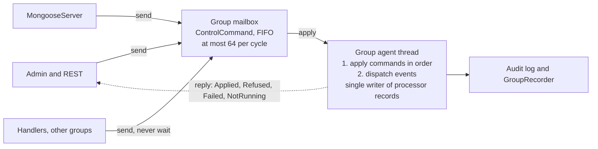

# Mongoose control plane as events — design

Status: proposal, 2026-10-24. Not yet reviewed; targets the release after 1.0.33. Code references are to the integration branch at `f54a768` (PR #69).

## Problem

Most of the defects fixed for 1.0.33 share one root cause: a processor's lifecycle state has no single owner. Several components on different threads each keep their own view, and the views drift apart. The fast event path, which runs on one thread with no locks, produced almost none of them.

| Defect | Fixed in | What drifted |
| --- | --- | --- |
| A stop sent while the add was still queued did nothing | #72 | The stop was checked before the queued add had run |
| The stop hook ran twice | integration commit, #72 with #74 | Two components each owned "stopped" |
| Audit captures stayed open after server stop | #65 | Audit lifetime was tracked apart from processor lifetime |
| Server stop refused to close audit captures on groups that had already stopped | integration commit, #65 with #74 | Shutdown asked closed groups to do work |
| A processor's name was released twice in a rare window | known, not fixed | The server's name reservations and the agent's drop path each release the name |
| Timers kept firing into a stopped processor | #72 (#71) | Scheduler bindings outlived the processor |
| A retry re-sent the event to every processor on the queue | #73 (#53) | Delivery was tracked per queue, not per processor |
| An add or remove of a subscriber waited up to 39.9 s | #52 | `publishLock` is an unfair Java monitor shared by the fast path and control calls |
| `runOnAgentThread` race | documented, not fixed | Hand-off to the agent thread plus reads of shared state from the caller |

Four of the 13 PRs needed extra commits on the integration branch just to work together, though none of them had merge conflicts. That coupling is the cost this design aims to remove.

## Goals and non-goals

The goal is one owner per piece of lifecycle state, and that owner is a single thread. Every change to a processor goes through that thread, in order, as a message.

**Goals**

1. Each processor group's agent thread is the only writer of its processors' lifecycle state, including name ownership and audit-capture lifetime.
2. All control requests to a group travel through one ordered mailbox, so a stop can never overtake the add it refers to.
3. Every control call returns a reply future with a definite outcome: applied, refused with a reason, or the group was not running.
4. Control messages are recorded in the audit log and replay stream like any other event.
5. The fast event path keeps its current cost: no new locks, allocation or branches per event.
6. Public API stays source compatible. Existing `void` methods keep working; new methods return the reply.

**Non-goals**

- Distribution, clustering or failover. Mongoose stays an in-process runtime.
- Changing how feeds publish into queues. `EventToQueuePublisher` keeps `publishLock` and the #52 fix; see Risks.
- Changing the plugin contract for connectors, services and admin commands.
- Changing Fluxtion's generated dispatch.

## Current control paths

The group already behaves like a mailbox, but it has four of them, and the server keeps state of its own beside them. Code references are to the integration branch at `f54a768`.

`ComposingEventProcessorAgent` has four control queues, all `ManyToOneConcurrentArrayQueue`, and `doWork()` drains them in a fixed order at the start of every duty cycle:

1. `toStopList`, names to stop (`checkForStopped`)
2. `toStartList`, suppliers that build a processor (`checkForAdded`)
3. `servicesToBroadcast`, service register and deregister (`checkForBroadcasts`)
4. `onAgentThread`, arbitrary `Runnable`s handed over by `runOnAgentThread`

The fixed order across queues is what lost a stop sent just after its add (#72). The fix drains `toStartList` before `toStopList`, which patches one pair but leaves the order between the others undefined.

**Who writes lifecycle state today**

| State | Lives in | Written by | Threads |
| --- | --- | --- | --- |
| Server lifecycle (NEW to STOPPED) | `MongooseServer.lifecycleState`, an `AtomicReference` | `start()`, `stop()`, `runOrderedStop()` | caller, or `mongoose-server-stop` |
| Processor name reservations | `MongooseServer.reservedProcessorNames`, a concurrent set | Added by `addEventProcessor` on the caller; removed on build failure, by `processorDropped` on the agent, and by a `runOnAgentThread` task queued by `stopProcessor` | caller and agent |
| Registered processors | `registeredEventProcessors`, a `ConcurrentHashMap` in the group | `startProcessor`, `release`, `onClose` | agent; read from any thread by `registeredProcessors()` |
| Audit capture per processor | `ChronicleAuditCaptureService.sinks` plus `synchronized` and `volatile` fields on each sink | `attach`, `start`, `stop`, `detach`, `stopAll`, using `AgentHandoff` to reach the agent | caller, agent, `mongoose-server-stop` |
| Group closed | `closed`, `agentThread` (`volatile`) | `onStart`, `onClose` | agent; read by callers |

**Where the threads meet**

- `addEventProcessor` and `stopProcessor` return before the group acts. The caller cannot learn whether the add started, failed and was dropped, or never ran.
- Stop is addressed by name. If a name is freed and reused, a stop meant for the old processor can find the new one. The reservation is freed after the stop to avoid that, which is the window where a name can be released twice.
- `runOnAgentThread` runs the work inline on the caller's thread when the group has not started or its thread has died. The same code therefore runs on two different threads depending on timing.
- `onClose` drains `onAgentThread` but not `toStartList` or `toStopList`. A processor added just before close is never built, and its name reservation is never released.
- Audit capture calls `AgentHandoff.submit` and waits up to its apply timeout. Server stop calls `stopAll()` after the groups have closed, so it has to skip the hand-off and forget the sinks first.
- Admin commands that change a processor run as lambdas outside an event cycle, so their audit records are unframed.

## Proposed model

Each group gets one ordered mailbox of control commands, and the group's agent thread is the only code that applies them. Callers send a command and get a reply future back. The server keeps no per-processor state of its own.

**One mailbox per group.** The four queues become one `ManyToOneConcurrentArrayQueue<ControlCommand>`. Commands are applied in the order they were accepted, at the start of a duty cycle, before any event is dispatched. A cycle applies at most a fixed number of commands, 64 to start with, so a burst of control cannot stall market data.

**Commands.** A sealed `ControlCommand` type with one record per request:

- `Add(name, supplier)` builds, wires and starts a processor.
- `Stop(name, generation?)` stops it and releases everything it holds.
- `Broadcast(service, register)` delivers or withdraws a service.
- `AuditStart(name)` and `AuditStop(name)` start and end an audit capture.
- `Close` stops every processor in order, then closes the group.
- `Run(task)` keeps `runOnAgentThread` working for plugins during migration. It is deprecated.

**Replies.** Every command carries a future that the agent thread completes with one of four outcomes:

- `Applied(handle)`, with the processor's name and generation where one applies
- `Refused(reason)`, for example a name already in use or no such processor
- `Failed(cause)`, for example `start()` threw and the processor was dropped
- `NotRunning`, when the group has closed

**The group owns names.** Each group keeps a plain `HashMap` from name to a processor record, written only by its agent thread. The record holds the processor, a generation number that increases with every add, its subscriptions and its audit-capture state. The server's `reservedProcessorNames` set is removed. A name is taken when an `Add` is applied and freed in the same step that removes the record, so it can be released only once. Other threads read a snapshot that the agent thread publishes after each change.

**No inline execution on the caller.** A command sent to a group that has not started waits in the mailbox and is applied in `onStart`. A command sent to a closed group completes at once with `NotRunning`. Group code never runs on a caller's thread.

**Close is a command.** Server stop sends `Close` to each group once its event sources have drained. The group applies every command accepted before the `Close`, stops each processor, ends each of their audit captures, then replies. `ChronicleAuditCaptureService.stopAll()` is no longer needed.

**Event path unchanged.** `doWork()` checks one `isEmpty()` where it checks four today. Dispatch is untouched.

## State machine

Because one thread applies each command whole, a processor has only two states that anyone can observe: absent or running. Building and starting happen inside one apply step, so "starting" and "stopping" are never seen from outside. The group has its own four states, and the table covers every command in every combination.

Group states: **New** (created, thread not started), **Running**, **Closing** (applying `Close`), **Closed**.

| Command | Group New | Running, name absent | Running, name present | Closing or Closed |
| --- | --- | --- | --- | --- |
| `Add(name)` | Queued; applied in `onStart` in order. A duplicate at boot fails the boot, as a failed start does today | Build and start. Success: `Applied(name, gen)`. A throw: record removed, name freed, `Failed(cause)` | `Refused("name in use")`. Nothing changes | `NotRunning` |
| `Stop(name)` | Queued; applied in order, so it stops a processor added before it | `Refused("no such processor")` | Stop, tear down, cancel timers, release subscriptions, replay bindings and audit capture; free name. `Applied(name, gen)`. A throw in `stop()` or `tearDown()` is reported and the release still completes | `NotRunning` |
| `Stop(name, gen)` | As above | `Refused("no such processor")` | Same as `Stop(name)` when `gen` matches. `Refused("generation changed")` when the name now belongs to a later add | `NotRunning` |
| `Broadcast(service)` | Queued | Delivered to no one; the service is still recorded for later adds | Delivered once to each running processor | `NotRunning` |
| `AuditStart(name)` | Queued | `Refused("no such processor")` | Install the capture listener. Already recording: `Applied`, no change | `NotRunning` |
| `AuditStop(name)` | Queued | `Refused("no such processor")` | Restore the configured listener, hand the queue off to be closed. Not recording: `Applied`, no change | `NotRunning` |
| `Close` | Group moves to Closed without starting; queued commands complete `NotRunning` | Apply everything accepted before it, stop every processor in add order, move to Closed | Same as previous column | A second `Close` completes `Applied` once the first finishes |

The cases that broke in 1.0.33 now each have one row:

- **Stop just after add (#72):** a single FIFO mailbox applies the `Add` first, so the `Stop` finds the processor.
- **Stop of an old processor hitting a new one:** `Stop(name, gen)` refuses when the name has moved on. `Stop(name)` from a caller that saw its own add complete is applied in order, so it cannot overtake that add.
- **Name released twice:** the name is freed only when the record leaves the group's map, on one thread, once.
- **Audit capture left open (#65):** the capture is part of the processor record and ends when the record is released, including by `Close`.

## Rules

These are the contract. Each one gets a named test (see Test plan), and the javadoc of the public methods states them.

1. **Single writer.** Only a group's agent thread changes that group's processor records, names, subscriptions, timers and audit-capture state.
2. **Order.** Commands to one group apply in the order the mailbox accepted them. Commands to different groups have no order between them.
3. **One outcome.** Every accepted command completes its future exactly once: `Applied`, `Refused`, `Failed` or `NotRunning`. None is left pending after the group closes.
4. **Control before events.** Commands apply at the start of a duty cycle, between event dispatches, never in the middle of one. A handler that sends a command to its own group sees it applied at the next cycle.
5. **Delivery.** Each event is delivered at least once to each processor that was running when it was dequeued. A retry goes only to the processor that threw (from #73).
6. **Fatal errors.** A `VirtualMachineError` is never caught, retried or turned into a reply. It goes to the agent's error handler.
7. **Names.** A name is taken when its `Add` applies and freed when its record is released, by stop, failed start or close. An `Add` applied after the `Stop` of the same name succeeds.
8. **Stop releases everything.** Stopping a processor runs `stop()` then `tearDown()`, cancels its timers, releases its subscriptions and replay bindings, ends its audit capture and frees its name. Each step runs even if an earlier one throws.
9. **Shutdown order.** Server stop drains event sources, then sends `Close` to each processor group, then stops service groups. Server stop returns only when every `Close` has replied or the drain timeout has passed.
10. **No waiting on an agent thread.** Code on any agent thread never blocks on another group's reply. Methods called from an agent thread return the future without waiting.
11. **Audit capture lifetime.** A capture never outlives its processor record.

## Threading and API

New methods return `CompletionStage<ControlReply>`. Existing `void` methods keep their signatures and wait for the reply only when that is safe.

| Method | Returns | Off an agent thread | On an agent thread |
| --- | --- | --- | --- |
| `addEventProcessor(...)` (existing) | `void` | Waits up to the control timeout; throws `IllegalArgumentException` on `Refused`, `ProcessorStartException` on `Failed` | Checks the name against the snapshot, throws on a duplicate, then queues without waiting |
| `addProcessor(...)` (new) | `CompletionStage<ControlReply>` | Never waits | Never waits |
| `stopProcessor(group, name)` (existing) | `void` | Waits up to the control timeout; logs a `Refused` | Queues without waiting |
| `stopProcessor(handle)` (new) | `CompletionStage<ControlReply>` | Never waits | Never waits |
| `audit.start` / `audit.stop` admin commands | admin reply | Waits; the admin reply carries the outcome text | Not called from agent threads |
| `runOnAgentThread(task)` (existing, deprecated) | `void` | Queues a `Run`; throws `IllegalStateException` on `NotRunning` | Runs inline, as today |

**Before the group starts.** `addEventProcessor` on a group whose thread has not started cannot wait, because nothing would answer. It queues the `Add` and returns. A refusal or failure then surfaces when the group starts, through the boot failure policy from #66. YAML config is checked for duplicate names when it loads, so the common case still fails early.

**Accept or refuse, never lose.** Sending uses the claim already in `AgentHandoff`. The sender offers the command, then re-reads the group's `closed` flag. If the group has closed, the sender claims the command and completes it `NotRunning`. The agent sets `closed` before its final drain and claims each command it finds. Whichever side claims first completes the future, so no command is applied twice or left pending.

**Full mailbox.** Sending backs off as `enqueue` does today, for up to the control timeout of 10 s. On the group's own thread a full mailbox fails at once with `IllegalStateException`.

**Reads.** `registeredProcessors()` and `isProcessorRegistered()` read an immutable snapshot that the agent thread replaces after each change. They never block and may lag by at most one apply step.

## Audit and replay

Once control is applied on the agent thread at a known point between events, it can be logged and recorded the same way events are.

**Audit.** Applying a command writes one framed audit record per affected processor: the command, the processor's name and generation, the outcome, and the cycle it was applied in. It goes through the processor's configured log record listener, so it lands in the same audit log as the processor's events. This also fixes admin commands that change a processor, whose records today are written outside an event cycle and come out unframed.

**Replay recording.** `GroupRecorder` writes each applied command into the recording at its position in the group's event sequence. A replay then sees "processor X stopped here" between the same two events as production did.

**Replaying an `Add`.** The supplier passed to `Add` is code and cannot be recorded. The recording stores the name and a factory key instead. Replay resolves the key against the processor factories registered for the replay, which for YAML-configured processors is the config entry. An `Add` whose key cannot be resolved stops the replay with an error naming it. Processors added from code with no key are recorded as unresolvable; see Risks.

**What is not recorded.** `Run(task)` is opaque code and is recorded as a marker only. That is one more reason to retire it.

## Migration plan

Six stacked PRs, each releasable on its own and each keeping the public API source compatible. They start after 1.0.33 ships.

1. **One mailbox.** Replace the four queues with one `ControlCommand` mailbox and internal reply futures. Behaviour is unchanged except that commands now apply strictly in order. This retires the #72 special case of draining starts before stops.
2. **Names move into the group.** Add the processor record with its generation, publish the read snapshot, delete `reservedProcessorNames` and the stop-time release task. This removes the double release of a name.
3. **Reply API.** Add `addProcessor` and `stopProcessor(handle)` returning `CompletionStage<ControlReply>`. Make the existing `void` methods wait off agent threads, as in Threading and API. Release note for the behaviour change.
4. **Close as a command.** Server stop sends `Close`; leftover commands complete `NotRunning`; remove the inline path from `runOnAgentThread` and remove `stopAll()`.
5. **Audit capture as commands.** Move capture state into the processor record and turn `audit.start` and `audit.stop` into commands. Opening and closing Chronicle queues moves to a helper thread so file I/O stays off the agent thread. Removes the `AgentHandoff` waits in `ChronicleAuditCaptureService`.
6. **Audit and replay of control.** Framed audit records for applied commands, control in `GroupRecorder`, factory keys for `Add`, admin commands routed through the mailbox.

PRs 1 and 2 carry most of the risk reduction. PRs 5 and 6 can wait if needed.

## Test plan

Each rule gets one test named after it, written before the PR that makes it pass. The regression tests from 1.0.33 stay and must pass unchanged at every step.

| Rule | Test | Lands in PR |
| --- | --- | --- |
| 1 Single writer | Every record, name and capture change asserts it runs on the group's thread (a debug-only check enabled in tests) | 2 |
| 2 Order | 10,000 interleaved add, stop and re-add of one name from 4 threads; the final state matches applying the accepted order | 1 |
| 3 One outcome | Commands sent while the group closes; every future completes, none twice, none left pending | 4 |
| 4 Control before events | A handler stops its own processor; the stop applies at the next cycle and no event is dispatched to it after | 1 |
| 5 Delivery | Existing #73 tests | 1.0.33 |
| 6 Fatal errors | Existing #73 and #57 tests, plus a `VirtualMachineError` thrown from `stop()` | 2 |
| 7 Names | Stop then re-add of the same name with no wait succeeds; two concurrent adds of one name give one `Applied` and one `Refused` | 2 |
| 8 Stop releases everything | Timers, subscriptions, replay bindings, audit capture and name all released when `stop()` and `tearDown()` both throw | 2 |
| 9 Shutdown order | Server stop with a feed outrunning a slow processor and a capture recording; returns within the drain timeout, capture closed | 4 |
| 10 No waiting on an agent thread | A handler calls the `void` add and stop on another group; nothing blocks | 3 |
| 11 Capture lifetime | Capture recording when its processor stops, is dropped, or the server stops; queue closed each time | 5 |

**Regression tests to keep:** `ProcessorStopReleaseTest`, `ProcessorStartFailureTest`, `RetryOnlyTheFailedProcessorTest`, `ServerStopEndsAuditCaptureTest`, `LifecycleRacesTest`, `AuditControlOnAgentThreadTest`, and `EventToQueuePublisher` `publishersInALoopDoNotStarveARemoveOrAnAdd`.

**Latency check.** A JMH run of the duty cycle with an empty mailbox, before and after PR 1, to confirm the fast path is no slower.

## Risks and open questions

The biggest risk is the behaviour change for callers of the existing `void` methods, which start waiting. The rest are open questions to settle before PR 3.

**Risks**

- **Callers that start waiting.** Code that calls `addEventProcessor` or `stopProcessor` off an agent thread will now wait for the group, up to 10 s. A caller that holds a lock the group needs could deadlock. Mitigation: release note, the timeout, and a server option to keep the old fire-and-forget behaviour for one release.
- **Closing a group that never started.** No agent thread exists to apply `Close`, so the server has to close it from its own thread. That is the one place group state is written off the agent thread. It needs a compare-and-set on the group state so a late `onStart` cannot race it.
- **Duplicate check on an agent thread.** A handler that adds two processors with the same name in one cycle passes the snapshot check twice; the second add is refused only when applied. The caller has no exception, only a `Refused` future and a log line.
- **Control latency.** Commands wait for the next duty cycle and at most 64 apply per cycle. A burst of 1,000 adds takes 16 cycles. Fine for control; worth stating.
- **Plugins using `runOnAgentThread`.** It is public. It stays, deprecated, until the plugins in mongoose-plugins move off it.
- **Feed publishing is still a lock boundary.** `EventToQueuePublisher.publishLock` remains, guarded by the #52 fix. Moving subscriber changes to a copy-on-write list owned by the subscribing group would remove it, but that touches the event path and is out of scope here.

**Open questions**

- [ ] Should `Close` on a group also wait for queued `Add`s to be applied and then stopped, or refuse them `NotRunning`? This design refuses them.
- [ ] What factory key do processors added from code get, so replay can rebuild them?
- [ ] Is 64 commands per cycle the right bound, and should it be configurable per group?
- [ ] Should a service `Broadcast` across several groups be all-or-nothing? Today and in this design each group applies it independently.
- [ ] Keep `Stop(name)` without a generation as the default, or require a handle in the new API?
